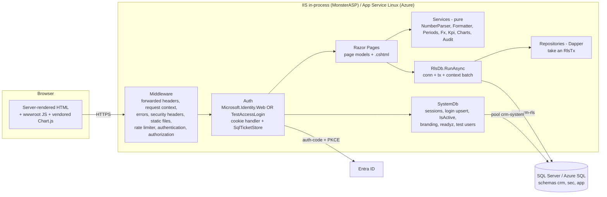

# Internal CRM: .NET 10 build reference

Status: Approved for build (rewrite decided by the product owner 2026-11-18; sub-decisions P1–P5 in [ADR-0007](../adr/0007-dotnet-10-rewrite.md) pending sign-off) · Owner: Architect · Related: [ADR-0007](../adr/0007-dotnet-10-rewrite.md), [overview.md](overview.md), [ADR-0001](../adr/0001-stack.md) to [ADR-0006](../adr/0006-test-access-code-login.md), [UI spec v0.3](../ux/ui-spec.md) and its reviews

This is the build reference for the ASP.NET Core rewrite. It replaces the **stack-specific** parts of [overview.md](overview.md): the component table and guardrail in §2, the pool and `withRlsContext` code in §8, the helmet/express parts of §10, the variable table in §11, and the iisnode parts of §12.3. Everything else in overview.md stays the reference and is **not repeated here**: data model and DDL (§4), RLS predicates and policies (§5), grants (§6), audit design (§7), serverless retry rules (§8.1), route/role table (§9), Azure resources and Entra setup (§12.1–12.2). Where this document and overview.md disagree on a stack detail, this document wins.

**The Node app (`src/`, `tests/`) is the functional reference.** When the spec is silent, do what the Node code does, and port the matching Node test. From the start of increment 0, Node gets security fixes only (no features, no UI changes), so the reference stays still.

---

## 1. What does not change

- Database: `db/migrations/001–004`, `db/seed/test-users.sql`, `db/manual/create-app-user.sql`, `db/tests/rls-integration.sql`. No new migration is needed for the rewrite.
- RLS contract: keys `UserId` (int), `Role` (nvarchar(10)), `TeamId` (int or NULL), all `@read_only = 1`, set in the first batch of a per-request transaction, behind the 51000 stale-context guard.
- Behaviour and copy: UI spec v0.3 + review-increment-2/3/4, all user-facing texts in the Node views and validators (copy them verbatim).
- Security decisions: Entra only on live hosts, app roles → role, groups → team (exactly one, overage fails closed), 50011 → `/no-access`, idle 60 min / absolute 10 h, `IsActive` re-check every 5 minutes, CSP without inline script, PNG-only logo, rate limits, `LIVE` refusals, test-access-code rules (ADR-0006).
- URLs: every GET and POST path in overview §9 stays the same (bookmarks, e2e scripts, the Entra redirect URI `/auth/redirect`).

## 2. Solution layout

During the rewrite the .NET code lives in `dotnet/`; at cutover it moves to the repository root (§16).

```
dotnet/
  Crm.slnx                         # .NET 10 default solution format
  Directory.Build.props            # net10.0, Nullable=enable, ImplicitUsings, TreatWarningsAsErrors, AnalysisLevel=latest-recommended
  Directory.Packages.props         # central package management, exact versions
  global.json                      # SDK 10.0.x, rollForward=latestFeature
  .editorconfig                    # formatter rules; CI runs `dotnet format --verify-no-changes`
  src/Crm.Web/
    Crm.Web.csproj                 # RestorePackagesWithLockFile=true; embeds ../../../db/**/*.sql (see §7)
    Program.cs                     # CLI dispatch (migrate | seed-test | run-sql) or web host
    web.config                     # IIS template WITHOUT secrets; publish fills in <aspNetCore> (§15.1)
    appsettings.json               # logging defaults only; never secrets
    Config/                        # CrmConfig, CrmConfigLoader (validation + refusals), ConnectionStringParser
    Data/                          # the ONLY place with SqlClient/Dapper: SqlConnectionFactory, RlsDb, RlsTx, SystemDb,
                                   #   DbRetry, Transient, DbErrorMapper, repositories, SqlTicketStore, Migrator, SqlBatches
    Auth/                          # EntraSignIn, TestAccessLogin, AttemptLimiter, CrmPrincipal, ReturnTo, Roles, SessionValidator
    Domain/                        # entity metadata (port of entities.ts), types, validators, settings validators
    Services/                      # pure: LocaleProfile, NumberParser, Formatter, Periods, Fx, Kpi, Charts, Color, LogoCheck, Audit
    Infrastructure/                # SecurityHeadersMiddleware, RequestContextMiddleware, RateLimitSetup, ErrorHandling, Branding
    Pages/                         # Razor Pages (+ _Layout, partials); one folder per area (Entity, Dashboard, Settings, Auth, Errors)
    wwwroot/                       # copy of src/public (css/app.css, js/*.js, vendor/chart.umd.js + LICENSE)
  tests/Crm.Tests/
    Crm.Tests.csproj
    Unit/                          # pure services, config, parsers (no SQL)
    Sql/                           # SqlServerFixture, migrator, RLS context, pool reset, repositories
    Http/                          # WebApplicationFactory tests (real SQL, signed in via the test-access-code flow)
    Architecture/                  # source-scan rules (§3.2)
```

**One web project, not several.** The app is about 5,000 lines; layering is enforced by folder + architecture tests (§3.2), which is cheaper than project references and gives the same guarantee.

**Packages** (exact versions pinned in `Directory.Packages.props`, lock files committed, `dotnet list package --vulnerable --include-transitive` in CI must report nothing High/Critical):

| Package | Licence | Use |
|---|---|---|
| Microsoft.Identity.Web | MIT | Entra OIDC (not used in test-access-code mode) |
| Microsoft.Data.SqlClient | MIT | SQL Server driver. If the major version in use ships Entra authentication in a separate package, add that package too (MIT) |
| Dapper | Apache-2.0 | Mapping. DateOnly/TimeOnly are supported with SqlClient ≥ 5.1; otherwise add a type handler |
| Azure.Monitor.OpenTelemetry.AspNetCore | MIT | App Insights, only wired when `APPLICATIONINSIGHTS_CONNECTION_STRING` is set |
| *tests:* xunit.v3, xunit.runner.visualstudio, Microsoft.NET.Test.Sdk | Apache-2.0 / MIT | test framework |
| *tests:* Microsoft.AspNetCore.Mvc.Testing | MIT | `WebApplicationFactory` |
| *tests:* Microsoft.Extensions.TimeProvider.Testing | MIT | `FakeTimeProvider` for timeouts, limiters, FX month logic |
| *tests:* AngleSharp | MIT | parse rendered HTML (no regex on markup) |

Not allowed: FluentAssertions 8 or later (commercial licence), Moq, EF Core, DbUp, any CDN asset. Use `Assert` and hand-written fakes.

All "now" values come from an injected `TimeProvider` (never `DateTime.UtcNow` directly), so every timeout is testable.

## 3. Components



### 3.1 Responsibilities

| Component | Responsibility | Must not |
|---|---|---|
| `Config/CrmConfigLoader` | Read every variable from `IConfiguration`, validate, apply refusals, return an immutable `CrmConfig` | Be bypassed: no other code reads `IConfiguration` keys or `Environment` |
| `Data/SqlConnectionFactory` | Build the two connection strings (RLS, system) once; open connections | Be used outside `RlsDb`, `SystemDb`, `Migrator` |
| `Data/RlsDb` | One connection + transaction per request, context batch, commit/rollback, error mapping | Run more than once per request; render; call external I/O inside the callback |
| `Data/RlsTx` | The only handle repositories get: `QueryAsync`, `QuerySingleOrDefaultAsync`, `ExecuteAsync`, `QueryMultipleAsync`, always on the transaction, one command at a time | Expose the raw `SqlConnection` or `SqlTransaction` |
| `Data/*Repository` | Parameterised SQL only; dynamic `ORDER BY` only from the whitelists in entity metadata | Concatenate user input into SQL |
| `Data/SystemDb` | Statements that must run without context (§6.4) | Touch RLS tables except the reads listed in §6.4 |
| `Data/SqlTicketStore` | `ITicketStore` over `app.Sessions` | Store tokens |
| `Auth/*` | Sign-in flows, principal building, session validation | Issue SQL directly (they call `SystemDb`) |
| `Services/*` | Pure functions: parsing, formatting, KPI, FX, periods, charts, colour, logo check, audit rows | Reference SqlClient, Dapper, `HttpContext` |
| `Pages/*` | Bind raw strings, validate with `Domain` validators, call `RlsDb.RunAsync` once, then render | Contain SQL; bind domain objects directly (overposting); parse numbers with model binding |

### 3.2 Architecture rules (enforced by `tests/Crm.Tests/Architecture`, source scans like today's `importRestrictions.test.ts`)

1. `Microsoft.Data.SqlClient` and `Dapper` appear only under `src/Crm.Web/Data/`.
2. `SqlConnectionFactory.OpenRls…` is referenced only by `RlsDb.cs`; `OpenSystem…` only by `SystemDb.cs`; the migrator uses its own single-connection factory method.
3. No `new SqlConnection(` outside `SqlConnectionFactory.cs` and `Migrator.cs`.
4. `Environment.GetEnvironmentVariable` and raw `IConfiguration["…"]` reads appear only in `Config/`.
5. No `Html.Raw(` in `.cshtml` except the JSON chart blocks (§11.7), each listed by file name in the test.
6. No `<script>` without `src=` and no `style=` attribute in `.cshtml` (CSP), except `<script type="application/json">`.
7. `Services/` does not reference `Microsoft.AspNetCore.*` or `Crm.Web.Data`.

## 4. Startup and request pipeline

`Program.cs`:
1. If `args[0]` is `migrate`, `seed-test` or `run-sql`, load **only** the database configuration (§5), run the migrator (§7), exit 0/1. No web host is built.
2. Otherwise load and validate the full configuration. On `ConfigException` write the list of problems (keys only, never values) to stderr and exit 1. Under IIS this shows as "HTTP 500.30"; the smoke test catches it.
3. Log a **warning** at startup when `AUTH_MODE=test-access-code`.
4. Run the startup self-checks (§11.3: time zone lookup). Failure logs an error and fails `/readyz`, but does not stop the app.

Middleware order (top to bottom):

| # | Middleware | Notes |
|---|---|---|
| 1 | `UseForwardedHeaders` | Only when `TRUST_PROXY > 0`; `ForwardLimit = TRUST_PROXY`, `KnownNetworks`/`KnownProxies` cleared (hop-count trust, like express `trust proxy = n`), `XForwardedFor | XForwardedProto` |
| 2 | `RequestContextMiddleware` | New GUID per request → `HttpContext.TraceIdentifier` and `Items["CorrelationId"]` (written to `AuditLog.CorrelationId`, shown as "Reference" on 500 pages); one log line per request at the end (§13.4) |
| 3 | `UseExceptionHandler("/error")` + `UseStatusCodePagesWithReExecute("/error/{0}")` | Developer exception page only in `Development` |
| 4 | `UseHsts` (when secure) + `SecurityHeadersMiddleware` | §13.1 |
| 5 | `UseStaticFiles` | `wwwroot` only, `Cache-Control: public, max-age=3600`; before auth, so static requests never touch the session store |
| 6 | `UseRouting` | |
| 7 | `UseRateLimiter` | Global, path-based partitions (§13.2); before authentication so the OIDC callback is limited too |
| 8 | `UseAuthentication` | Cookie scheme (+ OIDC scheme in `entra` mode) |
| 9 | `UseAuthorization` | Fallback policy: authenticated user; `[AllowAnonymous]` on public pages and endpoints |
| 10 | `NoStoreForAuthenticated` | `Cache-Control: no-store` on every response to an authenticated user (set in `OnStarting`) |
| 11 | Endpoints | `MapGet("/healthz")`, `MapGet("/readyz")`, `MapGet("/css/theme.css")`, `MapGet("/branding/logo")`, `MapRazorPages()` |

Kestrel/IIS: `AddServerHeader = false`; `MaxRequestBodySize = 1 MB` globally; `FormOptions.ValueLengthLimit` and urlencoded body limited to 100 KB (as `express.urlencoded({ limit: '100kb' })`); the logo page raises its own limit to 600 KB (§12).

`WebEncoderOptions.TextEncoderSettings = new TextEncoderSettings(UnicodeRanges.All)` so Razor emits "æøå" literally instead of numeric entities (still HTML-encoded for `<>&"'`).

No request localization middleware: the request culture is invariant. Locale-specific parsing and formatting always go through `Services/LocaleProfile` (§11).

## 5. Configuration

Environment variables are read through `IConfiguration` (environment variable provider; names contain no `__`, so they map 1:1). `CrmConfigLoader.Load(IConfiguration)` is a pure function over key/value pairs, unit-tested exactly like `tests/config.test.ts`. `appsettings.json` holds only logging defaults; `appsettings.*.json` must never hold secrets.

| Variable | Status | Rule (as Node unless stated) |
|---|---|---|
| `ASPNETCORE_ENVIRONMENT` | replaces `NODE_ENV` | `Production` (default under IIS and App Service), `Development` locally. `Testing` is used only by the test project's factory |
| `AUTH_MODE` | same | `entra` (default) or `test-access-code` |
| `TEST_ACCESS_CODE` | same | test-access-code only: ≥ 24 characters and ≥ 10 distinct characters; never logged |
| `TEST_ADMIN_NAME`, `TEST_ADMIN_EMAIL` | same | both or neither, only with test-access-code; same validation as `loadTestAdmin` |
| `REDIRECT_URI` | same, slightly stricter | required in `entra` mode and in Production; https in Production; origin = base URL (post-logout redirect, cookie `Secure`, HSTS). **New:** its path must be `/auth/redirect` (the OIDC callback path is fixed) |
| `ENTRA_TENANT_ID`, `ENTRA_CLIENT_ID`, `ENTRA_CLIENT_SECRET` | same | required in `entra` mode; GUIDs for the first two |
| `SESSION_IDLE_MINUTES` | same | 1–1440, default 60 |
| `SESSION_ABSOLUTE_HOURS` | same | 1–168, default 10 |
| `DB_AUTH_MODE` | same | `managed-identity`, `default-azure`, `sql-password` |
| `DB_CONNECTION_STRING` | same | sql-password only; parsed by the strict parser (port of `src/db/connectionString.ts` and its tests verbatim); exclusive with `DB_SERVER`/`DB_NAME`/`DB_USER`/`DB_PASSWORD`; never logged |
| `DB_SERVER`, `DB_NAME`, `DB_USER`, `DB_PASSWORD` | same | as today |
| `DB_TRUST_SERVER_CERT` | same | default false |
| `SQL_POOL_MAX` | same | 1–100, default 10 (RLS pool `Max Pool Size`) |
| `TRUST_PROXY` | same name, **new default 0** | 0–5. Default: **0 everywhere** (security review M1: forwarded headers are never trusted unless set explicitly; under IIS in-process there is no proxy hop). Set `TRUST_PROXY=1` explicitly behind a TLS-terminating proxy such as App Service Linux, otherwise the https redirect (secure cookies) would loop. Verify on each host with the "Your connection" line on Settings > Users & teams |
| `LIVE` | same | `LIVE=true` or `WEBSITE_INSTANCE_ID` set = live |
| `LOG_LEVEL` | same | maps to `Logging:LogLevel:Default` (`trace`…`fatal`, `silent` = `None`) |
| `APPLICATIONINSIGHTS_CONNECTION_STRING` | same | optional |
| `DATA_PROTECTION_KEYS_PATH` | **new** | folder for the Data Protection key ring (§9.4). Default: `%HOME%/ASP.NET/DataProtection-Keys` on App Service, `{ContentRoot}/App_Data/DataProtection-Keys` under IIS, user profile locally |
| `SESSION_SECRET` | **retired** | cookies are protected by Data Protection; if set, log an info line "SESSION_SECRET is not used by the .NET app" |
| `DEMO_MODE` | **removed** (P1) | if set to `true`, refuse to start: "DEMO_MODE is not supported" (so nobody assumes a bypass exists) |
| `PORT` | **removed** | the host decides (ANCM under IIS, `ASPNETCORE_HTTP_PORTS` on App Service) |
| `NODE_ENV` | **removed** | ignored |

**Startup refusals** (`ConfigException`, unit-tested one by one):
- `AUTH_MODE=test-access-code` and live (`LIVE=true` or `WEBSITE_INSTANCE_ID`);
- `AUTH_MODE=test-access-code` and `ENTRA_CLIENT_SECRET` set;
- `DB_AUTH_MODE=sql-password` (including via `DB_CONNECTION_STRING`) and live;
- `TEST_ACCESS_CODE` too short or too repetitive in test-access-code mode;
- `TEST_ADMIN_*` without test-access-code;
- `DEMO_MODE=true`;
- `ASPNETCORE_ENVIRONMENT=Testing` and live or `WEBSITE_SITE_NAME`/`WEBSITE_INSTANCE_ID` set (the test factory's environment must never run on a real host).

Error messages name keys only, never values.

## 6. Data access

### 6.1 Connection strings and pools

`SqlConnectionFactory` builds two strings once at startup with `SqlConnectionStringBuilder` (never string concatenation). SqlClient pools by exact connection string, so the different `Application Name` values give **two separate pools**:

| Setting | RLS pool | System pool |
|---|---|---|
| `Application Name` | `crm-rls` | `crm-system` |
| `Max Pool Size` | `SQL_POOL_MAX` (10) | 4 |
| `Min Pool Size` | 0 | 0 |

Common to both: `Encrypt=Mandatory`, `TrustServerCertificate` from config, `MultipleActiveResultSets=False` (forced, even if a parsed string says otherwise), `Pooling=True`, `Connect Timeout=15`, `Command Timeout=30`, `ConnectRetryCount=1` (default), `Persist Security Info=False`.

Authentication by `DB_AUTH_MODE`:
- `managed-identity`: `Authentication=Active Directory Managed Identity` (system-assigned identity, no user id).
- `default-azure`: `Authentication=Active Directory Default` (local dev with Azure CLI login).
- `sql-password`: `User ID`/`Password` from `DB_CONNECTION_STRING` (strict parser) or `DB_USER`/`DB_PASSWORD`.

`Min Pool Size=0` matters for serverless auto-pause: SqlClient prunes idle pooled connections after a few minutes, so the database sees no sessions long before the 60-minute pause delay (overview §8.1).

### 6.2 `RlsDb.RunAsync` (port of `withRlsContext`)

```csharp
public sealed record RlsContext(int UserId, CrmRole Role, int? TeamId);   // CrmRole: Admin | Manager | User

public interface IRlsDb
{
    // One call per request. Everything the page needs (including the per-request Settings/lookups read)
    // is collected inside fn; the page renders after the method returns (i.e. after commit).
    Task<T> RunAsync<T>(Func<RlsTx, Task<T>> fn, CancellationToken ct);
}
```

`RlsDb` is scoped (per request). It takes the `RlsContext` from the authenticated principal (never from input) and:
1. Validates the context (`UserId > 0`, role in the enum, `TeamId` null or > 0). Invalid → throws before any DB call.
2. Throws `InvalidOperationException` if called a second time in the same request (flag in `HttpContext.Items`), so "one connection + one transaction per request" is enforced, not just advised.
3. Inside `DbRetry` (§6.5): open a connection from the RLS pool, `BeginTransaction(IsolationLevel.ReadCommitted)`, run the context batch below. On failure: dispose, retry if transient.
4. Runs `fn(tx)`. Then `Commit()`.
5. On any exception: `Rollback()` if the transaction is still usable; if rollback itself throws, log and dispose the connection (SqlClient's reset on next reuse rolls back anything left, and the guard catches any context left). Map the exception (§6.6) and rethrow.
6. Transient errors after `fn` started are **not** retried (commit outcome could be ambiguous; a POST must not run twice) → 503 "Waking up the database" page.

Context batch (unchanged T-SQL; one command, three typed parameters):
```sql
IF SESSION_CONTEXT(N'UserId') IS NOT NULL OR SESSION_CONTEXT(N'Role') IS NOT NULL
  THROW 51000, 'Stale RLS context on pooled connection', 1;
EXEC sp_set_session_context @key = N'UserId', @value = @UserId, @read_only = 1;
EXEC sp_set_session_context @key = N'Role',   @value = @Role,   @read_only = 1;
EXEC sp_set_session_context @key = N'TeamId', @value = @TeamId, @read_only = 1;
```
Parameters: `@UserId` `SqlDbType.Int`; `@Role` `SqlDbType.NVarChar, Size = 10`; `@TeamId` `SqlDbType.Int` with `DBNull.Value` for no team.

Error 51000 is logged at `Error` as a security event with the user id.

### 6.3 Connection reset on reuse (verified; guard kept)

- SqlClient always resets a pooled connection when it is reused; the `Connection Reset` keyword is no longer honoured. The reset is **deferred**: when `Open()` returns a pooled connection, the driver sets the TDS `RESETCONNECTION` flag on the first request it sends (here: the `BEGIN TRANSACTION` request), and the server performs `sp_reset_connection` before executing it. That clears `SESSION_CONTEXT` (including read-only keys), temp tables, `SET` options and open transactions.
- Difference from the Node design: Node reset on **release**; SqlClient resets on **acquire**. The stale context therefore remains on an idle pooled connection until its next use. Nothing can use it without the reset happening first, so this is not a leak; the guard still covers the case of a reset that did not happen.
- **Proof in CI (required test, `Sql/PoolResetTests`):** a dedicated pool (`Max Pool Size=1`, unique `Application Name`), run `RunAsync` as user A, then as user B: the second call must succeed (no 51000), and `SELECT SESSION_CONTEXT(N'UserId')` inside it must return B. A second test sets a key with `@read_only = 1` on a raw pooled connection, closes it, reopens (same physical connection, verified by `@@SPID`) and asserts the key is NULL.
- No `ResettingConnectionPool` equivalent is written.

### 6.4 `SystemDb`

Opens a connection from the system pool per call, no transaction unless stated, never sets context (so RLS tables return 0 rows on it). Allowed statements (and only these):

| Use | Statement | Retry |
|---|---|---|
| Ticket store | `app.Sessions` get / insert / update / delete / cleanup | yes |
| Login | `EXEC crm.usp_UpsertUserOnLogin` | yes (idempotent MERGE) |
| `IsActive` re-check | `SELECT IsActive FROM crm.Users WHERE UserId = @id` | yes |
| Branding | `crm.Settings` (`app.name`, `branding.accentColor`) and `crm.BrandingAssets` (sha, content) | no (fallback to cache/defaults) |
| `/readyz` | `SELECT 1` | no |
| Test users (test-access-code only) | the two `testUserRepo` queries, ported verbatim | yes |

### 6.5 Retry (port of `retry.ts` and `transient.ts`)

- Transient: `SqlException.Number` in {40613, 40197, 40501, 40540, 49918, 49919, 49920, 4221, 10928, 10929}, or a connection-phase failure with number in {-2 (timeout), 20, 64, 233, 10053, 10054, 10060}. Inspect all `SqlException.Errors`. Everything else (33504, 547, 51000, 50011, 18456 …) is not transient.
- Backoff 1 s, 2 s, 4 s, 8 s, then 15 s, ±25 % jitter, total wait budget 60 s; `warn` per retry, `error` when exhausted; custom event `db.resume` with total wake time when App Insights is on.
- One shared "database waking" gate per instance: concurrent requests await the same wake attempt instead of each running its own loop.
- Do **not** use SqlClient's configurable retry logic: it would retry commands inside `fn`, which the design forbids.

### 6.6 Error mapping

| Condition | Response |
|---|---|
| `SqlException` 33504 (RLS block) | 403 page |
| 547 (FK) | friendly 409 message on the page (copy from Node) |
| 2627 / 2601 (unique) | validation error on the field (copy from Node) |
| optimistic concurrency miss (`@@ROWCOUNT = 0`, row still visible) | 409 conflict page |
| row not visible | 404 (no existence leak) |
| 51000 | 500 + security log |
| transient (budget exhausted, or after `fn` started) | 503 + `Retry-After: 15` + "Waking up the database" page (UI spec v0.3; `wake.js` reused) |

### 6.7 Dapper conventions

- Every call goes through `RlsTx` (which passes `transaction:` and `commandTimeout:`) or `SystemDb`. Calling Dapper on a connection that has an open transaction without passing it throws in SqlClient; the wrapper makes that impossible.
- **One active command at a time.** MARS is off. `RlsTx` holds a `SemaphoreSlim(1)`; every method awaits it, so even a `Task.WhenAll` in page code runs sequentially (port of `txQueue.ts`). Queries are buffered (Dapper default), so the reader is closed before the method returns; `QueryMultipleAsync` returns a reader that must be fully consumed and disposed inside the semaphore scope (wrap it: `QueryMultipleAsync(sql, param, Func<GridReader, Task<T>> read)`).
- Parameter types are explicit where the column is `varchar`/`char` (`new DbString { Value = …, IsAnsi = true, Length = n }`) to avoid implicit conversions that defeat indexes (`SettingKey`, `CurrencyCode`, `ActivityType`, `EntityType`). `nvarchar` columns use `IsAnsi = false` with the column length.
- `RowVer` is `byte[]` in C#, base64 in the hidden form field; updates use `WHERE Id = @Id AND RowVer = @RowVer`; on 0 rows run the visibility check (overview §8).
- `TeamId` on insert/update is always `(SELECT TeamId FROM crm.Users WHERE UserId = @OwnerId)` in SQL; it is never bound from a form.
- Audit rows (overview §7) are inserted in the same transaction, values taken from `OUTPUT deleted.*, inserted.*`, formatted invariantly (`.` decimal, ISO dates), truncated to 4000.
- Dynamic SQL is limited to whitelisted fragments from `Domain/EntityDefinitions` (sort columns, search columns), exactly like `entities.ts`.

## 7. Migrator (`dotnet Crm.Web.dll migrate | seed-test | run-sql <file>`)

Port of `scripts/migrate.ts`, `scripts/sqlBatches.ts`, `scripts/runSqlFile.ts`, `scripts/testAdminSeed.ts`. Runs as the deployer / DB owner identity, never as the app user.

- **Sources:** `db/migrations/*.sql` and `db/seed/test-users.sql` are compiled into `Crm.Web.dll` as embedded resources (`<EmbeddedResource Include="../../../db/migrations/*.sql" LogicalName="migrations/%(Filename)%(Extension)" />`, same for seed). No SQL files are deployed to the web root. `run-sql` reads a file path given on the command line.
- **Connection:** one connection, `Pooling=False`, command timeout 300 s, built from the same DB variables (§5).
- **Bootstrap:** the same `IF OBJECT_ID(N'dbo.SchemaVersions') IS NULL CREATE TABLE …` as today.
- **Ordering and names:** `^(\d{3})_(.+)\.sql$`, sorted by name.
- **Checksum (must be byte-identical to the Node runner, or applied migrations would be reported as changed):** SHA-256 over the file's **raw bytes after replacing every `0D 0A` with `0A`**, lower-case hex. Do not decode-and-re-encode (`File.ReadAllText` would strip a BOM; Node keeps it). Unit test: checksums of 001–004 equal golden values computed once with `sha256sum` (the files are LF without BOM today), and a CRLF copy gives the same value. Recommend a `.gitattributes` line `*.sql text eol=lf` (developer).
- **Batches:** split on lines matching `^\s*GO\s*(--.*)?$` (case-insensitive), after CRLF→LF; trim; drop empty.
- **Apply:** per pending file, one transaction: all batches, then `INSERT dbo.SchemaVersions (Version, Name, Checksum)`. Failure → rollback, exit 1 with "Migration X failed and was rolled back: {SQL error number and message}". Applied file with a different checksum → exit 1 "changed after it was applied".
- **Assert** both `CrmRowPolicy` and `CrmConfigPolicy` are enabled at the end; otherwise exit 1 (message as today).
- **`seed-test`:** runs the embedded `test-users.sql`, then the optional named Admin upsert. `TestAdminOid(email)` must produce **exactly** the Node value: `"00000000-0000-4000-8000-" + hex(SHA256(UTF8("crm-test-admin:" + email.Trim().ToLowerInvariant())))[0..12]`, so the existing seeded row is updated, not duplicated. Unit test with a golden value from the Node function.
- **`run-sql`:** same behaviour as `scripts/runSqlFile.ts` (self-contained `GO` batches, report SQL error number, line and procedure per failing batch, continue, exit 1 if any batch failed or any result row says `FAIL`).
- Logs never contain the connection string or password.

## 8. Authentication

### 8.1 Principal (both modes)

After sign-in the cookie principal carries only these claims (built by `CrmPrincipal.Create`):

| Claim | Value |
|---|---|
| `ClaimTypes.NameIdentifier` | Entra `oid` (lower-case). Antiforgery binds tokens to it |
| `crm:uid` | `crm.Users.UserId` |
| `ClaimTypes.Role` | `Admin` / `Manager` / `User` |
| `crm:tid` | `TeamId` or absent |
| `name`, `email` | display only |
| `crm:authAt` | Unix ms of sign-in (absolute timeout) |

`RlsContext` is derived from `crm:uid`, role and `crm:tid` only. Authorization policy `Admin` = role Admin; the `/Settings` folder is authorized with it (`AuthorizeFolder("/Settings", "Admin")`), returning the 403 page (not a redirect). RLS remains the real enforcement.

### 8.2 Entra mode (`AUTH_MODE=entra`, ADR-0003 rules unchanged)

`AddAuthentication(cookie as default, OIDC as challenge).AddMicrosoftIdentityWebApp(...)`, configured **in code from `CrmConfig`** (not from an `AzureAd` config section, so the env var names stay):

| Setting | Value |
|---|---|
| Instance / TenantId / ClientId / ClientSecret | `https://login.microsoftonline.com/`, `ENTRA_TENANT_ID`, `ENTRA_CLIENT_ID`, `ENTRA_CLIENT_SECRET` (single tenant) |
| `CallbackPath` | `/auth/redirect` (unchanged → no app registration change) |
| `ResponseType` / `UsePkce` | `code` / `true` (S256) |
| `ResponseMode` | `query` (ADR-0003: the callback is a top-level GET, so `SameSite=Lax` cookies are sent) |
| `Scope` | `openid profile email` |
| `SaveTokens` | `false`; no token acquisition, no downstream API, no token cache |
| `MapInboundClaims` | `false` (keep `oid`, `tid`, `roles`, `groups`, `hasgroups`, `_claim_names` as-is) |
| `CorrelationCookie` / `NonceCookie` | `SameSite=Lax`, `HttpOnly`, `Secure` when secure |
| `redirect_uri` | forced to `REDIRECT_URI` in `OnRedirectToIdentityProvider` (do not derive from the request host behind proxies) |
| `IdentityModelEventSource.ShowPII` | `false` |

`GET /auth/login?returnTo=…` → `Challenge` with `RedirectUri = ReturnTo.Safe(returnTo)` (port of `safeReturnTo`: starts with a single `/`, not `//`, no `\`, no control characters, ≤ 2000, else `/`). State, nonce and PKCE are created and validated by the handler.

`OnTokenValidated` (logic in `Auth/EntraSignIn`, unit-tested without HTTP):
1. `tid` must equal `ENTRA_TENANT_ID` (case-insensitive), else fail → sign-in error page (`signin-error`, with Reference).
2. Role = highest of `CRM.Admin` > `CRM.Manager` > `CRM.User` in `roles`; unknown values ignored. None → log info with `oid`, `HandleResponse()`, redirect 303 `/no-access`, no session.
3. Groups: overage if `_claim_names` (a JSON claim) contains `groups`, or there is no `groups` claim and `hasgroups` is `true` → `@GroupIdsJson='[]'`, `@GroupsOverage=1`. Otherwise all `groups` claim values, lower-cased.
4. `EXEC crm.usp_UpsertUserOnLogin` via `SystemDb` (retry). `SqlException` 50011 → warn with `oid`, `HandleResponse()`, 303 `/no-access`.
5. Team policy (port of `applyTeamPolicy`): `ok` with exactly one match → TeamId; `multiple` → NULL + warning with `oid` and count; `overage` → NULL + error with `oid`; `none` → NULL.
6. Replace `context.Principal` with `CrmPrincipal.Create(...)`; the handler then signs in to the cookie scheme, which creates a **new** ticket store row (fixation-safe).

Remote failures (`OnRemoteFailure`, e.g. state/correlation mismatch, IdP error) → log warn with reason, `HandleResponse()`, render `signin-error` with 400 (502 when code redemption failed), as Node does.

`POST /auth/signout` (antiforgery-protected): remove the ticket store row, delete the cookie, then 303 to `https://login.microsoftonline.com/{tenant}/oauth2/v2.0/logout?post_logout_redirect_uri={baseUrl}/signed-out` (same URL as today; no `id_token_hint`, since no tokens are kept). In test-access-code mode: 303 `/signed-out`.

Hardening later (configuration only, no code change in flows): replace the client secret with a federated credential from the managed identity (`ClientCredentials` with `SignedAssertionFromManagedIdentity`).

### 8.3 Test-access-code mode (`AUTH_MODE=test-access-code`, ADR-0006 rules unchanged)

The OIDC handler is **not registered**. `/auth/login` redirects to `/auth/test-login`.

| Rule | .NET implementation |
|---|---|
| Code compare | `CryptographicOperations.FixedTimeEquals(SHA256(given), SHA256(expected))` (no length leak) |
| Per-client limit | `AttemptLimiter` (port of `rateLimiter.ts`, failures only): 5 failures / 15 min per client IP → 429; success resets the client's counter |
| Global cap | second `AttemptLimiter(50)` with one key: 50 failures / 15 min across all clients locks the form for everyone (warning logged); success does **not** reset it |
| Client key | `Connection.RemoteIpAddress` after forwarded headers. If null (only happens under `TestServer`), key on `conn:{Connection.Id}` and log a warning; never one shared "unknown" bucket |
| Request limit | all `/auth/*` 120 requests / min / IP (§13.2) |
| Verified-code window | 10 minutes, held in a separate cookie `__Host-crm.tac` (HttpOnly, Secure, SameSite=Strict, Path=/), value protected with `ITimeLimitedDataProtector` (purpose `crm.test-access.v1`, lifetime 10 min). Deleted after a user is chosen |
| Picker | the 7 fixed `TEST_USERS` oids **plus** any active `crm.Users` row whose `EntraOid` is in the reserved range `00000000-0000-4000-8000-xxxxxxxxxxxx` (the named Admin); lookup re-checks the range in SQL; any other oid → 403 "That test user is not available." |
| Session | `CrmPrincipal.Create` from the DB row, then `SignInAsync` (new ticket row): identical RLS path to Entra |
| Banner | "TEST ENVIRONMENT — test data only" on every page (layout reads `CrmConfig.AuthMode`) |
| Logging | wrong code / locked: warn with IP; success: info with `oid` and role; the code is never logged |
| Copy | exact texts from `test-login-code.ejs`, `test-login-user.ejs` and `testLogin.ts` (401 "That access code is not correct.", 429 locked state) |

Go-live removal list for the .NET app: `Auth/TestAccessLogin*`, `Auth/AttemptLimiter`, the test-user queries in `SystemDb`, `Pages/Auth/TestLogin*`, the `seed-test` command and embedded `test-users.sql`, the `test-access-code` value, `TEST_ACCESS_CODE`/`TEST_ADMIN_*`, the banner; delete seeded users from any database carried forward (ADR-0006 constraint 3 applies to these files).

## 9. Sessions, cookies, antiforgery

### 9.1 Cookie authentication with `SqlTicketStore`

| Option | Value |
|---|---|
| Cookie name | `__Host-crm.session` when secure, else `crm.session` (the `__Host-` prefix needs `Secure`). New name, so old Node cookies are simply ignored |
| `HttpOnly` / `SameSite` / `Path` / `SecurePolicy` | true / `Lax` / `/` / `Always` when `REDIRECT_URI` is https |
| `SessionStore` | `SqlTicketStore` |
| `ExpireTimeSpan` | `SESSION_ABSOLUTE_HOURS`; `SlidingExpiration = false` (idle timeout is enforced in the store, see below) |
| `IsPersistent` | false (browser-session cookie) |
| `LoginPath` handling | `OnRedirectToLogin`: GET → 303 `/signin?returnTo={safe original path+query}`; other methods → 303 `/signin`; append `reason=expired` or `reason=disabled` when `HttpContext.Items["crm.signout.reason"]` is set |
| `OnRedirectToAccessDenied` | status 403, rendered by the status code page (no redirect) |
| `OnValidatePrincipal` | `SessionValidator` (§9.2) |

`SqlTicketStore : ITicketStore` on `SystemDb`:
- **Key:** 32 random bytes, base64url (43 chars), as `Sid`.
- **Data:** JSON (System.Text.Json) of `{ v: 1, userId, oid, name, email, role, teamId, authAt, activeCheckedAt }`. No tokens, no serialized `AuthenticationTicket`. The principal is rebuilt from it.
- `StoreAsync`: insert with `ExpiresAt = now + SESSION_IDLE_MINUTES`.
- `RetrieveAsync`: `SELECT Data, ExpiresAt FROM app.Sessions WHERE Sid = @sid AND ExpiresAt > SYSUTCDATETIME()`. If found and the last touch is more than 1 minute old, `UPDATE … SET ExpiresAt = now + idle` (rolling idle timeout like express `rolling: true`, with at most one write per minute per session).
- `RenewAsync`: update `Data` (used when `activeCheckedAt` changes) and `ExpiresAt`.
- `RemoveAsync`: delete the row.
- **Cleanup:** after a response completes, at most once per 15 minutes per instance, `DELETE TOP (1000) … WHERE ExpiresAt < SYSUTCDATETIME()` while rows are affected. Never on a timer (it would keep a serverless database awake).
- All operations use `DbRetry`.
- Revocation runbook is unchanged: delete the user's rows from `app.Sessions` (search `Data` for the `oid`).

### 9.2 `SessionValidator` (port of `requireAuth`)

In `OnValidatePrincipal`, using `TimeProvider`:
1. `now - authAt > SESSION_ABSOLUTE_HOURS` → `RejectPrincipal()`, remove the ticket, `Items["crm.signout.reason"] = "expired"`.
2. `now - activeCheckedAt > 5 min` → `SystemDb` `IsActive` check. Inactive (or row missing) → reject, remove, reason `disabled`. Active → set the new `activeCheckedAt` in the ticket and `ShouldRenew = true` (the handler calls `RenewAsync` with the same key). `activeCheckedAt = authAt` at sign-in, so the first check happens 5 minutes after sign-in.
3. The rejected request then hits the authorization challenge → 303 `/signin?reason=…` (§9.1).

### 9.3 Antiforgery and TempData

- Razor Pages validate antiforgery on every POST handler automatically; the form tag helper emits the token (`<form method="post">`). Cookie `__Host-crm.af` (HttpOnly, Secure, SameSite=Strict); form field name `_csrf` (keeps the Node field name; `FormFieldName = "_csrf"`), header `X-CSRF-TOKEN`.
- Failure must be **403** with the error page, as in Node (Razor Pages default is 400): an `IAlwaysRunResultFilter` converts `IAntiforgeryValidationFailedResult` into the 403 page.
- Tokens are bound to the user (`NameIdentifier` claim), so signing in invalidates pre-login tokens: the equivalent of "CSRF token rotated on login".
- The multipart logo POST is validated by the same mechanism (the token is a form field in the multipart body); no special path like `MULTIPART_PATH` is needed.
- The OIDC callback is handled by the authentication middleware and is not a page handler, so antiforgery does not apply to it (state + PKCE protect it).
- Flash messages ("Saved and assigned to {name}." etc.) use TempData with the cookie provider: cookie `__Host-crm.tmp`, HttpOnly, Secure, SameSite=Lax, `IsEssential = true`.

### 9.4 Data Protection

Session cookies, antiforgery tokens, TempData and the test-access cookie are protected with ASP.NET Core Data Protection. `SetApplicationName("crm")`; `PersistKeysToFileSystem(DATA_PROTECTION_KEYS_PATH)`.
- **Azure App Service:** `/home/ASP.NET/DataProtection-Keys` (persistent, shared by instances). Later hardening: wrap keys with Key Vault (`Azure.Extensions.AspNetCore.DataProtection.Keys`, MIT).
- **MonsterASP:** `{ContentRoot}\App_Data\DataProtection-Keys`. Web Deploy must **skip** `App_Data` (no delete), or every deploy signs everyone out. Keys are unencrypted XML on the host's disk: acceptable for the test host only (test data, same exposure as the secrets in `web.config`).
- Losing the key ring signs everyone out and makes open forms fail with 403 once. No data is lost.

## 10. Pages and routes

Paths are exactly those of overview §9. Razor Pages with explicit `@page` route templates; `{id:int:min(1)}` constraints make invalid ids 404 (as zod did).

| Area | Pages | Notes |
|---|---|---|
| Public | `/signin`, `/signed-out`, `/no-access` (403), `/error/{code}` | `[AllowAnonymous]`; branding from the public cache |
| Auth | `/auth/login`, `/auth/test-login` (GET/POST), `/auth/test-login/user` (POST), `/auth/signout` (POST) | `/auth/redirect` is the OIDC callback path, not a page |
| Probes | `GET /healthz` (text `ok`, no DB), `GET /readyz` (`SELECT 1` on the system pool, result cached 10 s, `ok`/`fail`, 200/503) | minimal endpoints, anonymous |
| Branding | `GET /css/theme.css`, `GET /branding/logo` | minimal endpoints, anonymous (§12) |
| Dashboard | `/`, `/analytics` | |
| Search | `/search?q=` | grouped top 5 |
| Entities | `/{entity}`, `/{entity}/new`, `/{entity}/{id}`, `/{entity}/{id}/edit`, `/{entity}/{id}/delete` + POST `/{entity}`, `/{entity}/{id}`, `/{entity}/{id}/delete`; `/opportunities/{id}/won|lost`, `/activities/{id}/done|undone` | **Generic pages** driven by `Domain/EntityDefinitions` (port of `entities.ts`), with a custom route constraint `crmentity` = `accounts|contacts|opportunities|activities`. One list, form, detail and delete page, like the EJS views |
| Settings (Admin) | `/settings` → 302 `/settings/general`; `general` (+ POST `general/logo`), `locale`, `fx` (+ `fx/{id}/edit`, `fx/{id}`, `fx/{id}/delete`), `stages`, `picklists` → 302 `picklists/industry`, `picklists/{code}`, `visibility`, `users`, `teams` (POST), `teams/{id}/edit`, `teams/{id}` (POST), `teams/{id}/deactivate` (GET/POST), `teams/{id}/reactivate` (POST) | `AuthorizeFolder("/Settings", "Admin")` |

Page model pattern:
```csharp
public async Task<IActionResult> OnPostAsync(string entity, int id, CancellationToken ct)
{
    var form = EntityForm.From(Request.Form, def);              // raw strings only, no model binding of numbers
    var result = await _rls.RunAsync(async tx =>
    {
        var lookups = await _lookups.LoadAsync(tx);             // settings, stages, picklists in the same tx
        var v = EntityValidator.Validate(def, form, lookups);  // port of validators.ts, same messages
        if (!v.Ok) return SaveResult.Invalid(v, lookups);
        // visible-reference checks, owner-picker check, UPDATE ... WHERE RowVer = @RowVer, audit rows
        return await _repo.UpdateAsync(tx, def, id, v.Values, ct);
    }, ct);
    return result.Match(/* redirect 303 | re-render with errors | 404 | 409 */);
}
```

Rules carried over from Node (see `src/routes/crm.ts`, `crmViews.ts`, `settings.ts`, `dashboard.ts`):
- POST success → 303 redirect (PRG). Validation failure → re-render with the error summary partial and field messages, status 200 as Node does.
- Ownership hand-off ("Saved and assigned to {name}.") when the saved record is no longer visible.
- Owner picker: non-Admins see self + active team-mates; the choice is validated against that list before writing.
- Delete button only for Admin, owner, or Manager of the record's team.
- Entity references (`AccountId`, `ContactId`, `OpportunityId`) must be visible under RLS before writing ("Choose an account from the list.").
- Lists: search, filters, sort, paging all in the query string; impossible calendar dates rejected (Q1); Overdue / Today / Next 7 days are disjoint (QA-F3).
- No model binding of domain objects; `[BindProperty]` only on small input records of strings; `TeamId` never bound.

Views: port `src/views/partials/head.ejs`/`foot.ejs` to `Pages/Shared/_Layout.cshtml`; `error-summary.ejs`, `settings-nav.ejs` to partials; each page `.ejs` to one `.cshtml` with the same markup, classes, ids, ARIA attributes and copy (UX review compares them side by side). Use tag helpers for forms, links and `asp-append-version="false"` (cache headers stay as today).

## 11. Domain services (pure, unit-tested)

### 11.1 Locale profiles (no dependence on host globalization)

Windows hosts may format with NLS or a different ICU version than Linux (for example Windows NLS formats da-DK dates as `18-11-2026`; ICU and the Node app give `18.11.2026`). So separators and patterns for the three allowed locales are **pinned in code**:

| Locale | Group | Decimal | Date | Time |
|---|---|---|---|---|
| `da-DK` | `.` | `,` | `dd.MM.yyyy` | `HH:mm` |
| `en-GB` | `,` | `.` | `dd/MM/yyyy` | `HH:mm` |
| `en-US` | `,` | `.` | `MM/dd/yyyy` | `h:mm tt` (AM/PM, regular space) |

Unknown locale codes fall back to `en-GB` (as Node). Formatting uses a cloned `NumberFormatInfo`/`DateTimeFormatInfo` (from `CultureInfo.InvariantCulture`) with these values set explicitly; never `CultureInfo.CurrentCulture`. Keep `InvariantGlobalization=false` (needed for time zones, §11.3).

### 11.2 Number parsing (port of `parseDecimal`, `tests/numberParsing.test.ts` verbatim)

`NumberParser.ParseAmount(string input, string locale)` and `ParseRate(...)` return `ParseResult { Ok, Value (decimal), Reason: Format | Negative }`:
- Trim; a leading `-` → `Negative`.
- Integer part: plain digits **or** properly grouped (1–3 digits, then groups of exactly 3 separated by the locale's group separator). Rates: plain digits only (`allowGrouping = false`).
- Optional decimal part: the locale's decimal separator + 1..N digits (amounts N = 2, rates N = 6, see ADR-0007 P5).
- Regex uses **`[0-9]`, not `\d`**: in .NET `\d` matches any Unicode digit (the test case `'١٢٣'` must be rejected). Add `RegexOptions.CultureInvariant`, and anchor with `^…\z`: in .NET, `$` also matches before a final `\n`, so `"5\n"` would pass.
- No spaces, no `+`, no exponent, no hex, no empty string. The other locale's separator is an error, never silently dropped (`"6,8"` in en-GB, `"12.5"` and `"7.4590"` in da-DK).
- Value in `decimal`; reject values above 99,999,999,999,999.
- Examples in messages: `AmountExample` = `12.500,00` / `12,500.00`; `RateExample` = `7,4590` / `7.4590`.
- `IsRealDate("yyyy-MM-dd")`: regex `^[0-9]{4}-[0-9]{2}-[0-9]{2}$`, `DateOnly.TryParseExact(..., InvariantCulture)`, year ≥ 1900.

### 11.3 Dates and time zones

- Date-only values (`CloseDate`, `DueDate`) are `DateOnly`; never converted through a time zone.
- `TodayIn(timezone)` and `DateTime` display use `TimeZoneInfo.FindSystemTimeZoneById(ianaId)`. .NET resolves IANA ids on Windows only when ICU is available. **Startup self-check:** resolve `Europe/Copenhagen` and the configured `locale.timezone`; on failure log an error, fall back to UTC for display (as Node does for an invalid zone) and report `fail` on `/readyz`. Settings > Locale validates the zone with the same lookup.
- If the MonsterASP spike (§16, increment 0) shows no ICU, switch the time zone code to NodaTime (Apache-2.0, embedded tz database); the `TimeZones` service interface hides the choice.

### 11.4 Periods, FX, KPI, charts (ports of `periods.ts`, `fx.ts`, `kpi.ts`, `charts.ts`)

- Calendar arithmetic on `DateOnly` (`new DateOnly(y, m, 1).AddMonths(n)`); same functions and names (`MonthRange`, `QuarterRange(fiscalStartMonth)`, `FiscalYearRange`, `ResolvePeriod` with the `shown` rule and the exact error strings, `MonthsBetween` max 60).
- FX (ADR-0005): rate = 1 CURRENCY in BASE; base is always 1; lookup = reference month or latest earlier month, never a later one; missing → excluded and counted per currency; notes "N opportunities in SEK not included: no FX rate" and "Uses latest rate for N currencies" verbatim.
- **Money is `decimal` end to end** (SQL `decimal(19,2)` and `decimal(19,8)` map exactly). Round only the final total, `Math.Round(x, 2, MidpointRounding.AwayFromZero)`. The Node app used doubles; where a ported test's expected value differs in the last cent, the decimal result is correct: fix the expected value and note it in the test.
- KPI tiles: same keys, labels, contexts, hrefs (`computeTiles`); win rate = won / (won + lost) over 90 days, `null` when no closed deals.
- Charts: the page writes chart data as `<script type="application/json" id="…">@Html.Raw(JsonSerializer.Serialize(data, ChartJson.Options))</script>`. `ChartJson.Options` uses the **default** `JavaScriptEncoder` (escapes `<`, `>`, `&`, `'`, `+`), never `UnsafeRelaxedJsonEscaping`, so the JSON cannot close the script element. `wwwroot/js/charts.js` reads it unchanged. Every chart has its data-table fallback.

### 11.5 Formatting (port of `makeFormatter`)

`Money(amount, currency)` = `"{currency} {amount:N2 with profile separators}"`; `Date(DateOnly)`; `DateTime(DateTime utc)` converted to the Settings zone; `AmountInput` (no grouping, 0–2 decimals, locale decimal separator); `RateInput` (0–6 decimals). Audit values use `CultureInfo.InvariantCulture`.

### 11.6 Validators

Port `src/domain/validators.ts` and `settingsValidators.ts` as plain C# functions returning `(values, errors)` keyed by field name, with **identical messages**. Do not use DataAnnotations (messages and locale rules are custom). Colour contrast (`color.ts`: `AccentContrast` = min(contrast on white, on `#F9FAFB`) ≥ 4.5; `Darken`) ported 1:1.

## 12. Branding, logo, theme

- **Public branding cache** (singleton): app name, accent colour, logo SHA; TTL 30 s; on DB error serve the last value or defaults and retry after 5 s (never wait for a paused database on the sign-in page). Invalidated on save on the same instance. `_Layout` injects it.
- **`GET /css/theme.css`:** `:root { --color-primary: {accent}; --color-primary-hover: {Darken(accent)}; }`. The accent is validated `^#[0-9A-Fa-f]{6}$` on write and again here (fallback `#1D4ED8`). `Content-Type: text/css; charset=utf-8`, `Cache-Control: no-cache`, strong ETag (SHA-256 of the CSS, first 16 hex), 304 on `If-None-Match`. Must not exist as a file in `wwwroot`.
- **Logo upload** (`POST /settings/general/logo`, Admin, multipart, antiforgery): `[RequestSizeLimit(600_000)]` and `[RequestFormLimits(MultipartBodyLengthLimit = 600_000)]`; read the single `IFormFile` into memory; `LogoCheck`: 1..512,000 bytes, PNG magic `89 50 4E 47 0D 0A 1A 0A` and `IHDR` at bytes 12–15, else "Logo must be a PNG, 500 KB or smaller."; content starting with `<svg`/`<?xml` (first 512 bytes) → "SVG logos are not supported. Upload a PNG, 500 KB or smaller." The file name and declared content type are ignored. Store `image/png`, SHA-256, audit `branding`.
- **`GET /branding/logo`:** rate limited (§13.2); `ETag "{sha}"`, `Cache-Control: no-cache`, `X-Content-Type-Options: nosniff`, `Content-Security-Policy: default-src 'none'; style-src 'unsafe-inline'; sandbox`; 304 on match; bytes cached in memory by SHA. Rendered only via ``.

## 13. Cross-cutting

### 13.1 Security headers (`SecurityHeadersMiddleware`, replaces helmet)

Set on every response (logo endpoint overrides CSP):
- `Content-Security-Policy: default-src 'self'; script-src 'self'; style-src 'self'; img-src 'self' data:; object-src 'none'; frame-ancestors 'none'; base-uri 'self'; form-action 'self' https://login.microsoftonline.com` + `; upgrade-insecure-requests` when secure.
- `Referrer-Policy: same-origin`, `X-Content-Type-Options: nosniff`, `X-Frame-Options: SAMEORIGIN`, `Cross-Origin-Opener-Policy: same-origin`, `Cross-Origin-Resource-Policy: same-origin`, `Origin-Agent-Cluster: ?1`, `X-DNS-Prefetch-Control: off`, `X-Permitted-Cross-Domain-Policies: none`, `X-XSS-Protection: 0` (helmet's defaults, so header tests port unchanged).
- HSTS via `UseHsts` (`max-age=31536000; includeSubDomains`) only when `REDIRECT_URI` is https.
- No `Server` / `X-Powered-By` (Kestrel option + `web.config`, §15.1).

### 13.2 Rate limiting (built-in `Microsoft.AspNetCore.RateLimiting`)

One `GlobalLimiter` = `PartitionedRateLimiter` keyed by (policy, client IP), policy chosen by path:

| Path | Limit |
|---|---|
| `/auth/*` (includes the OIDC callback `/auth/redirect` and the test login) | 120 / 60 s fixed window per IP |
| `/readyz` | 30 / 60 s per IP (and the probe result is cached 10 s) |
| `/branding/logo` | 120 / 60 s per IP |
| everything else | no limiter |

`RejectionStatusCode = 429`; `OnRejected` sets `Retry-After` (seconds left in the window) and writes `Too many requests` as text. `QueueLimit = 0`. The failed-attempt limiter for the access code is separate (§8.3), because the built-in limiter counts requests, not failures. All limiters are in memory per instance (single instance on both hosts; not a WAF).

### 13.3 Forwarded headers and client IP

See §4 and `TRUST_PROXY` in §5. Settings > Users & teams keeps the line "Your connection: IP {RemoteIpAddress} (X-Forwarded-For hops trusted: {TRUST_PROXY})" so operators can verify it on each host. On App Service Linux, if the platform's automatic forwarded-headers setting is on, our middleware still decides (it runs first and consumes the hops it trusts); set `ASPNETCORE_FORWARDEDHEADERS_ENABLED=false` to avoid double processing.

### 13.4 Logging

- `Microsoft.Extensions.Logging` with the JSON console formatter (stdout). Under IIS, stdout goes to the ANCM log only when `stdoutLogEnabled="true"` (troubleshooting only). App Insights via Azure Monitor OpenTelemetry when configured.
- One line per request: correlation id, user id, **route template** (not raw path or query, which can contain names), status, duration. `Microsoft.AspNetCore.*` categories at `Warning`, so framework request logs with full URLs are not written.
- Never log tokens, cookies, form bodies, email or names, connection strings, the access code. Log `oid`, not email.

### 13.5 Errors

`/error` and `/error/{code}` pages port `error.ejs`, `no-access.ejs`, `conflict.ejs`, `waking.ejs`, `signin-error.ejs` with the same copy. Custom exceptions (`ForbiddenException`, `NotFoundException`, `ConflictException`, `DbWakingException`) are mapped by one exception handler. 500 pages show "Reference: {correlation id}". IIS `httpErrors existingResponse="PassThrough"` lets these pages through.

## 14. Testing

### 14.1 Layers

| Layer | Runs against | Covers |
|---|---|---|
| Unit (`Unit/`) | nothing external | config loader and refusals, connection string parser, number parsing, formatting, periods, FX, KPI, charts, colour, logo check, return-to, role mapping, groups/overage, team policy, attempt limiter, code compare, batch splitter, checksum golden values, `TestAdminOid` golden value, transient classification, retry backoff (with `FakeTimeProvider`) |
| SQL (`Sql/`) | real SQL Server | migrator (fresh DB, re-run is a no-op, changed file refused, policies asserted), context batch and guard (51000 when context pre-set), pool reset proof (§6.3), one-command-at-a-time wrapper, every repository, ticket store, login upsert incl. 50011, `IsActive` |
| HTTP (`Http/`) | `WebApplicationFactory<Program>` + real SQL | every route's status codes and redirects, antiforgery 403, rate limits 429 + `Retry-After`, security headers, `no-store`, session idle/absolute/disabled flows (with `FakeTimeProvider`), test-access-code flow end to end, RLS-visible behaviour per role and visibility mode (404 for hidden rows, 403 for blocked writes), ownership hand-off, conflict page, logo upload, theme.css, branding |
| Entra flow | unit + one HTTP test | `EntraSignIn` logic with claim sets (roles, tenant mismatch, overage via `_claim_names` and via `hasgroups`, multiple teams, 50011). HTTP: `/auth/login` returns 302 to the authorize endpoint with `response_mode=query`, `code_challenge_method=S256`, `redirect_uri=REDIRECT_URI`; the OIDC metadata is supplied by a static `OpenIdConnectConfiguration` in the test factory (no network) |
| RLS script | real SQL Server | `db/tests/rls-integration.sql` via `run-sql` in CI; any FAIL fails the build |
| e2e | deployed or local app | the `e2e/*.cjs` Playwright journeys re-pointed at the .NET app in test-access-code mode (QA decides whether to keep them in Node or move to Playwright for .NET, Apache-2.0) |

No fake SQL driver: everything that touches SQL is tested against SQL Server. Tests sign in through the **real** test-access-code flow (`SignInAsAsync(client, oid)` helper: GET code page, POST code with antiforgery token, POST user), so production code contains no test bypass.

### 14.2 SQL Server for tests

- **CI:** GitHub Actions service container `mcr.microsoft.com/mssql/server:2022-latest` (`ACCEPT_EULA=Y`, `MSSQL_PID=Developer`, SA password generated per run in the workflow, health check with `sqlcmd`/TCP). Developer edition is licensed for dev/test; RLS and `SESSION_CONTEXT` behave as on Azure SQL.
- **Locally:** the same image via `docker run`; tests read `CRM_TEST_SQL_SA` (an SA connection string). Without it, SQL and HTTP tests are skipped locally, but CI sets `CRM_REQUIRE_SQL=true` and they **fail** instead of skipping.
- **Fixture:** per test collection, create a fresh database `crm_test_{guid}`, run the migrator (as SA = deployer), create a SQL login + user `crm_app_test` in `crm_app_role` (as `create-app-user.sql` does for SQL logins), run `seed-test`. The app under test connects **as `crm_app_test`**, so grants and RLS are real. Drop the database at the end.
- **Windows leg:** a `windows-latest` job runs the unit tests only (no Linux containers on Windows runners), to catch globalization, time zone and path differences between the Linux CI and the Windows/IIS host.

### 14.3 CI requirements (for DevOps; workflow files are theirs)

On every push: `dotnet restore --locked-mode`, `dotnet format --verify-no-changes`, `dotnet build -c Release` (warnings as errors), `dotnet test` (Linux job with the SQL service, Windows job unit-only), `run-sql db/tests/rls-integration.sql` against the CI database, `dotnet list package --vulnerable --include-transitive` (fail on High/Critical), `dotnet publish` artifact (no secrets). Node CI keeps running until cutover.

### 14.4 Porting the Node tests

Each Node test file maps to a .NET test class; QA tracks the list until all are ported or explicitly retired:

| Node | .NET | Node | .NET |
|---|---|---|---|
| `config.test.ts` | `Unit/ConfigLoaderTests` | `connectionString.test.ts` | `Unit/ConnectionStringParserTests` |
| `numberParsing.test.ts` | `Unit/NumberParserTests` (all cases verbatim) | `kpi.test.ts`, `qaFinalKpi.test.ts` | `Unit/KpiTests`, `Unit/FxTests` |
| `domain.test.ts` | `Unit/ValidatorTests`, `Unit/PeriodsTests` | `roles.test.ts`, `userSync.test.ts` | `Unit/EntraSignInTests` |
| `transient.test.ts` | `Unit/TransientTests`, `Unit/DbRetryTests` | `testLogin.test.ts` | `Http/TestAccessLoginTests` |
| `requireAuth.test.ts` | `Http/SessionValidatorTests` | `sessionStore.test.ts` | `Sql/TicketStoreTests` |
| `withRlsContext.test.ts`, `pool.test.ts`, `sqlConcurrency.test.ts` | `Sql/RlsDbTests`, `Sql/PoolResetTests` | `sqlRepo.test.ts`, `sqlAdmin.test.ts` | `Sql/*RepositoryTests` |
| `sqlBatches.test.ts`, `rlsScript.test.ts` | `Unit/SqlBatchesTests`, `Sql/MigratorTests` | `importRestrictions.test.ts` | `Architecture/SourceRulesTests` |
| `app.test.ts`, `securityBatch.test.ts`, `lowFixes.test.ts` | `Http/SecurityHeadersTests`, `Http/RateLimitTests`, `Http/AppTests` | `crmHttp.test.ts`, `qaIncrement1–3.test.ts` | `Http/EntityPagesTests` |
| `dashboardHttp.test.ts` | `Http/DashboardTests` | `settingsHttp.test.ts` | `Http/SettingsTests` |
| `entraFlow.test.ts` | `Http/EntraChallengeTests` + `Unit/EntraSignInTests` | | |

Tests of demo mode and the memory store are retired (P1).

## 15. Hosting

### 15.1 MonsterASP.NET (IIS, interim test host)

- **Publish:** `dotnet publish dotnet/src/Crm.Web -c Release -o out` (framework-dependent, `net10.0`, no RID). Requires the .NET 10 hosting bundle on the host (verify in increment 0). Fallback if unavailable: `-r win-x64 --self-contained true` (needs only the ASP.NET Core Module v2 from any installed hosting bundle).
- **`web.config`:** committed template in `Crm.Web` with **no secrets**; publish adds `<aspNetCore processPath="dotnet" arguments=".\Crm.Web.dll" hostingModel="inprocess" stdoutLogEnabled="false" stdoutLogFile=".\logs\stdout">`. The template also contains: `requestFiltering removeServerHeader="true"`, `requestLimits maxAllowedContentLength="1048576"`, `fileExtensions` denying `.json`, `.sql`, `.config`, `.env`, `.pdb` (defence in depth), `hiddenSegments` `App_Data`, `logs`; `httpProtocol/customHeaders` removing `X-Powered-By`; `httpErrors existingResponse="PassThrough"`; WebSockets off.
- **Secrets (ADR-0007 option A):** the deploy job takes the published artifact, writes `<environmentVariables>` into `web.config`'s `<aspNetCore>` element **with an XML library** (proper escaping of `&`, `<`, `"`; never string replacement): `ASPNETCORE_ENVIRONMENT=Production`, `AUTH_MODE=test-access-code`, `REDIRECT_URI=https://crmtest.runasp.net/auth/redirect`, `DB_AUTH_MODE=sql-password`, `DB_CONNECTION_STRING`, `TEST_ACCESS_CODE`, optional `TEST_ADMIN_*`, `TRUST_PROXY` (start with 0 and verify), `DB_TRUST_SERVER_CERT`, `DATA_PROTECTION_KEYS_PATH` (optional). The secret-bearing `web.config` exists only inside the deploy job; it is never uploaded as an artifact, never echoed. `LIVE` and `ENTRA_CLIENT_SECRET` are never set on this host. `crm.env` and `iisnode-entry.js` are not used any more.
- **Web Deploy:** `-enableRule:AppOffline` (the in-process app locks its DLLs), `-skip` rule for `App_Data` (Data Protection keys, §9.4) and `logs`. Smoke test: `/healthz` 200 `ok`, `/signin` 200, `/readyz` 200 (DB reachable, time zone check passed).
- **Migrations:** from a developer PC or a runner allowed by the database firewall: `dotnet run --project dotnet/src/Crm.Web -c Release -- migrate` (and `seed-test`), with the `DB_*` variables set, exactly like today's `npm run db:migrate`.
- The database-owner gap (overview §12.3, ADR-0006) is unchanged.
- `docs/deploy/monsterasp.md` must be rewritten for .NET by DevOps in increment 1.

### 15.2 Azure App Service (target)

- App Service **Linux**, runtime stack `DOTNETCORE|10.0`, HTTPS only, TLS 1.2+, FTP/basic auth off, Always On (prod), health check `/healthz`, system-assigned managed identity (overview §12.1 otherwise unchanged).
- App settings (env vars): `ASPNETCORE_ENVIRONMENT=Production`, `LIVE=true`, `AUTH_MODE=entra`, `REDIRECT_URI`, `ENTRA_TENANT_ID`, `ENTRA_CLIENT_ID`, `ENTRA_CLIENT_SECRET` (Key Vault reference), `DB_AUTH_MODE=managed-identity`, `DB_SERVER`, `DB_NAME`, `TRUST_PROXY=1`, `ASPNETCORE_FORWARDEDHEADERS_ENABLED=false`, `DATA_PROTECTION_KEYS_PATH=/home/ASP.NET/DataProtection-Keys`, `APPLICATIONINSIGHTS_CONNECTION_STRING`. `session-secret` in Key Vault is no longer needed.
- Deploy: zip deploy of the publish output; migrations run in the pipeline as the deployer identity (`DB_AUTH_MODE=default-azure` with a federated GitHub identity).
- `crm_app` contained user from the managed identity, exactly as overview §6.

## 16. Increments and cutover

Each increment ends with the usual definition of done (QA PASS, security PASS, UX PASS for UI work, CI green). The Node app is frozen (security fixes only) from increment 0.

| # | Scope | Acceptance criteria |
|---|---|---|
| **0 Foundation + spikes** | Solution skeleton, packages, `Directory.*`; config loader with all refusals; security headers; `/healthz`, `/readyz`; layout, wwwroot copy, error pages, branding cache, `theme.css`, `/branding/logo`; data layer (`SqlConnectionFactory`, `RlsDb`, `RlsTx`, `SystemDb`, retry, error mapping); migrator (`migrate`, `seed-test`, `run-sql`); test fixture; CI with SQL service container. **Spikes on MonsterASP:** a hello-world .NET 10 in-process app (hosting bundle present?), IANA time zone lookup, `App_Data` writable, `RemoteIpAddress` vs `X-Forwarded-For`, env vars from `web.config` | Migrator applies 001–004 to an empty CI database, records checksums equal to the golden values, refuses a modified file, asserts policies; `rls-integration.sql` all PASS in CI; `PoolResetTests` and the guard test pass; config tests ported and green; architecture rules green; security headers equal the Node set; spike results written into this document (§17) |
| **1 Auth + sessions + first deploy** | Ticket store; cookie auth; `SessionValidator`; test-access-code flow with both limiters, picker, banner; Entra flow; sign-out; antiforgery (403); rate limits; `/signin`, `/signed-out`, `/no-access`; empty dashboard shell; MonsterASP deploy of .NET (P2) with web.config env injection | All ADR-0006 rules covered by tests; idle/absolute/disabled flows pass with `FakeTimeProvider`; `/auth/*` 429 after 120; Entra challenge test green; deployed test site: sign in with code, pick each seeded user, banner visible, "Your connection" shows the real public IP |
| **2 CRM core** | Entity metadata, generic list/detail/form/delete pages for the four entities, search, owner picker, references check, optimistic concurrency, audit, won/lost, done/undone, ownership hand-off | Ported `crmHttp`, `qaIncrement1–2`, `sqlRepo` tests green against real SQL; RLS behaviours (404 hidden, 403 blocked, team-mode update yes / delete no, takeover then delete) verified over HTTP per role; UX side-by-side review vs Node pages PASS |
| **3 Dashboard + analytics** | Periods, FX, KPI, charts JSON + fallback tables, waking page, exclusion notes | Ported `kpi`, `qaFinalKpi`, `dashboardHttp`, `qaIncrement3` tests green (decimal expected values documented where they differ); review-increment-4 findings still satisfied |
| **4 Settings** | General (name, accent, logo PNG), locale, FX (6 decimals), stages, picklists, visibility, users & teams | Ported `settingsHttp`, `sqlAdmin` tests green; Admin-only enforced by policy and by RLS (33504 → 403) |
| **5 Parity and cutover** | e2e journeys against .NET; full QA, security and UX review of the .NET app; docs updated; Node removed (P3); tree moved to root | Every Node test mapped in §14.4 is ported or explicitly retired; e2e green; no open Critical/High; product owner sign-off for deletion |

**Deleted at cutover (one commit, after sign-off):** `src/` (Node), `tests/` (Node), `e2e/*.cjs` if ported, `scripts/`, `dist/`, `package/`, `node_modules/`, `package.json`, `package-lock.json`, `tsconfig.json`, `tsconfig.build.json`, `eslint.config.mjs`, `vitest.config.mts`, `deploy/iis/` (iisnode `web.config`, `iisnode-entry.js`), `deploy/crm.env.example`, the Node jobs in `.github/workflows/ci.yml` and the Node steps in `deploy-test.yml`; `app.Sessions` rows (everyone signs in again). **Kept:** all of `db/` (migrations, seed, manual, tests incl. `generate-rls-integration.py`).

**Then (same increment, separate commit):** `git mv dotnet/src/Crm.Web src/Crm.Web`, `dotnet/tests/Crm.Tests tests/Crm.Tests`, `dotnet/Crm.slnx` and `Directory.*` to the root; fix the embedded-resource paths and CI paths. Update CLAUDE.md §3–§4 (commands: `dotnet restore`, `dotnet run --project src/Crm.Web`, `dotnet test`, `dotnet format --verify-no-changes`, `dotnet publish`), README, `docs/deploy/monsterasp.md`, and mark the Node-specific sections of overview.md as historical.

## 17. Open items and verification log

| Item | Owner | Status |
|---|---|---|
| MonsterASP has the .NET 10 hosting bundle (in-process) | Developer/DevOps, increment 0 spike | open |
| MonsterASP: IANA time zones resolve (ICU present) | spike | open; fallback NodaTime |
| MonsterASP: `App_Data` writable by the app pool; Web Deploy skip rule keeps it | spike | open |
| MonsterASP: is there a proxy in front of IIS (decides `TRUST_PROXY`)? | spike | open |
| SqlClient major version: Entra auth in core package or extension package | Developer | check at package pinning |
| ADR-0007 P1–P5 | Product owner | pending sign-off |
