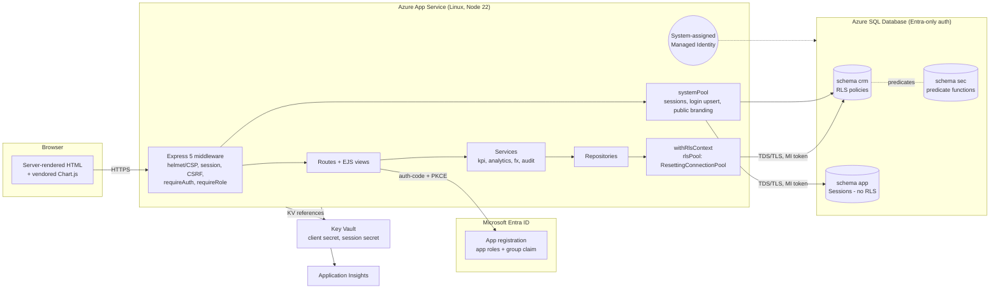
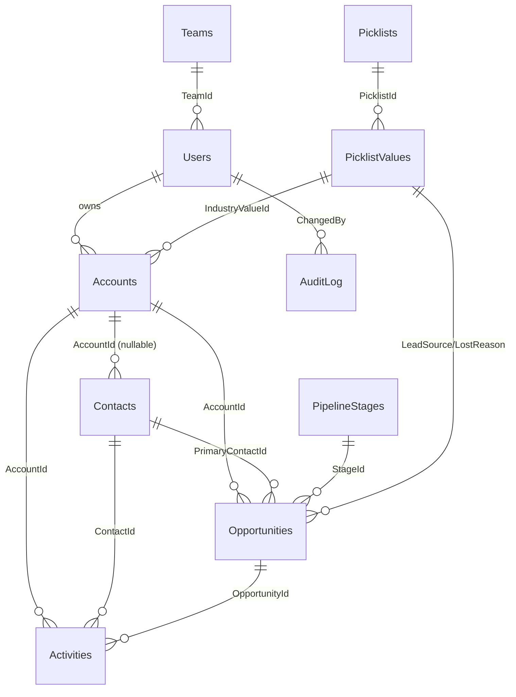

# Internal CRM: Architecture Overview (v1)

Status: Approved for build (user decisions 2nd round, 2026-11-18) · Owner: Architect · Related: [ADR-0001](../adr/0001-stack.md) to [ADR-0005](../adr/0005-fx-rates.md), [UI spec](../ux/ui-spec.md)

This is the build reference. Where it conflicts with the plan, this document and the ADRs take precedence. Section 13 lists the deviations.

---

## 1. Context and goals

This is a small internal CRM (about 10 to 200 users) for Accounts, Contacts, Opportunities and Activities, with a dashboard, an analytics page and Admin settings.

- **Hosting:** Azure App Service (Linux, Node 22) and Azure SQL Database, in an EU region.
- **Sign-in:** Microsoft Entra ID. The app never stores passwords.
- **Data access:** enforced in the database by Row-Level Security (RLS). The app sets the identity, and the database decides which rows are visible. A bug in a query must not be able to leak rows.
- **Non-functional targets:** see CLAUDE.md §8. Key pages render in under 2 s. Availability is business hours. WCAG 2.2 AA. GDPR applies and data is hosted in the EU.

## 2. Components



| Component | Responsibility | Must not |
|---|---|---|
| `src/config.ts` | Load and validate env vars with zod. Fail fast on startup. | Read env vars anywhere else |
| `src/auth/msal.ts` | MSAL `ConfidentialClientApplication`: login URL, code redemption, logout URL | Persist tokens |
| `src/auth/session.ts` + `sessionStore.ts` | `express-session` with the custom SQL store (ADR-0004) | Use `rlsPool` |
| `src/auth/userSync.ts` | Map roles and groups, then call `crm.usp_UpsertUserOnLogin` on `systemPool` | Touch other tables |
| `src/auth/requireRole.ts` | `requireAuth`, `requireRole('Admin')`, role hierarchy | Be the only line of defence for rows (RLS is) |
| `src/db/pool.ts` | Create `rlsPool` (a `ResettingConnectionPool`) and `systemPool` | Export `rlsPool` to anything except `withRlsContext.ts` |
| `src/db/withRlsContext.ts` | Transaction per request, set session context, commit or rollback | Render views or call external I/O inside the callback |
| `src/db/repositories/*` | Parameterised SQL only, taking a `Transaction` argument | Concatenate user input into SQL |
| `src/services/*` | KPI maths, FX conversion, audit row building. Pure functions where possible, so they can be unit-tested. | Import `mssql` |
| `src/routes/*` | Validate input (zod), call services and repositories, render | Contain SQL |

**Guardrail (increment 1 acceptance criterion):** an ESLint `no-restricted-imports` rule allows `src/db/pool.ts` to be imported only by `src/db/withRlsContext.ts`, `src/auth/sessionStore.ts`, `src/auth/userSync.ts` and `src/db/publicReads.ts`. A unit test greps `src/` for `new sql.Request(` and `.query(` outside `src/db/`.

## 3. Request flows

### 3.1 Sign-in (auth-code + PKCE, ADR-0003)

```mermaid
sequenceDiagram
  autonumber
  participant U as Browser
  participant A as App
  participant E as Entra ID
  participant D as Azure SQL
  U->>A: GET /accounts (no session)
  A-->>U: 302 /signin?returnTo=/accounts
  U->>A: GET /auth/login?returnTo=/accounts
  A->>A: PKCE verifier/challenge, state, nonce → session.auth (saved to app.Sessions)
  A-->>U: 302 authorize?response_mode=query&code_challenge=…&state=…&nonce=…
  U->>E: sign in (+MFA per tenant policy)
  E-->>U: 302 /auth/redirect?code=…&state=…
  U->>A: GET /auth/redirect
  A->>A: state == session.auth.state (timing-safe)
  A->>E: acquireTokenByCode(code, codeVerifier)
  E-->>A: id_token claims (oid, tid, name, email, roles, groups)
  A->>A: tid == ENTRA_TENANT_ID, nonce matches, role = highest(roles) or no-access
  A->>D: EXEC crm.usp_UpsertUserOnLogin (systemPool)
  D-->>A: UserId, TeamId
  A->>A: session.regenerate(); session.user = {userId, oid, name, email, role, teamId, authAt}; new csrfToken
  A-->>U: 302 /accounts (returnTo validated: starts with "/" and not "//")
```

### 3.2 Authenticated request (auth → session → withRlsContext → query)

```mermaid
sequenceDiagram
  autonumber
  participant U as Browser
  participant M as Middleware
  participant H as Route handler
  participant W as withRlsContext
  participant P as rlsPool
  participant D as Azure SQL
  U->>M: GET /opportunities/42 (cookie __Host-crm.sid)
  M->>M: load session (systemPool → app.Sessions), idle/absolute timeout check
  M->>M: requireAuth → req.rls = {userId, role, teamId}; POST → CSRF check
  M->>H: next()
  H->>H: zod-validate params/query
  H->>W: withRlsContext(req.rls, tx => repo.getOpportunity(tx, 42))
  W->>P: new Transaction(rlsPool).begin(READ_COMMITTED)
  W->>D: guard + sp_set_session_context UserId/Role/TeamId @read_only=1
  W->>D: SELECT … WHERE OpportunityId=@id (RLS filter applied by engine)
  D-->>W: 0 or 1 row
  W->>D: COMMIT (or ROLLBACK on error)
  W->>P: release → tedious Connection.reset() → sp_reset_connection → back to pool
  W-->>H: result
  H-->>U: 200 render, or 404 if no row (no existence leak)
```

## 4. Data model (schema `crm`)

Conventions:
- Surrogate keys are `int IDENTITY`. AuditLog uses `bigint`.
- All timestamps are `datetime2(3)` in UTC (`SYSUTCDATETIME()`). Dates without a time (`CloseDate`, `DueDate`) are `date`, interpreted in the timezone set in Settings.
- Money is `decimal(19,2)`. FX rates are `decimal(19,8)`.
- Text is `nvarchar`. Codes are `varchar` or `char`.
- **Entity tables** (Accounts, Contacts, Opportunities, Activities) all carry the common columns: `OwnerId int NOT NULL FK Users`, `TeamId int NULL FK Teams`, `CreatedBy int NOT NULL FK Users`, `CreatedAt`, `ModifiedBy int NOT NULL FK Users`, `ModifiedAt` and `RowVer rowversion`.
- **Server-side TeamId:** the app never takes `TeamId` from a form. It sets `TeamId = (SELECT TeamId FROM crm.Users WHERE UserId = @OwnerId)` on every insert and on every owner change.
- **Foreign keys use `NO ACTION`** (no cascades). SQL Server rejects multiple cascade paths here. Explicit app logic is also easier to audit. See §4.3.



### 4.1 DDL (migration `001_schema.sql`)

```sql
CREATE SCHEMA crm AUTHORIZATION dbo;
GO
CREATE SCHEMA sec AUTHORIZATION dbo;
GO
CREATE SCHEMA app AUTHORIZATION dbo;
GO

CREATE TABLE dbo.SchemaVersions (
  Version    int           NOT NULL CONSTRAINT PK_SchemaVersions PRIMARY KEY,
  Name       nvarchar(200) NOT NULL,
  Checksum   char(64)      NOT NULL,            -- SHA-256 of the file; migrate refuses if an applied file changed
  AppliedAt  datetime2(3)  NOT NULL CONSTRAINT DF_SchemaVersions_AppliedAt DEFAULT SYSUTCDATETIME()
);

CREATE TABLE crm.Teams (
  TeamId       int IDENTITY(1,1) NOT NULL CONSTRAINT PK_Teams PRIMARY KEY,
  Name         nvarchar(80)     NOT NULL CONSTRAINT UQ_Teams_Name UNIQUE,
  EntraGroupId uniqueidentifier NOT NULL CONSTRAINT UQ_Teams_EntraGroupId UNIQUE,
  IsActive     bit              NOT NULL CONSTRAINT DF_Teams_IsActive DEFAULT 1,
  CreatedAt    datetime2(3)     NOT NULL CONSTRAINT DF_Teams_CreatedAt DEFAULT SYSUTCDATETIME(),
  ModifiedAt   datetime2(3)     NOT NULL CONSTRAINT DF_Teams_ModifiedAt DEFAULT SYSUTCDATETIME(),
  ModifiedBy   int              NULL,       -- FK added after Users exists
  RowVer       rowversion       NOT NULL
);

CREATE TABLE crm.Users (
  UserId       int IDENTITY(1,1) NOT NULL CONSTRAINT PK_Users PRIMARY KEY,
  EntraOid     uniqueidentifier NOT NULL CONSTRAINT UQ_Users_EntraOid UNIQUE,
  TenantId     uniqueidentifier NOT NULL,
  DisplayName  nvarchar(200)    NOT NULL,
  Email        nvarchar(254)    NULL,
  Role         varchar(10)      NOT NULL CONSTRAINT CK_Users_Role CHECK (Role IN ('Admin','Manager','User')),
  TeamId       int              NULL CONSTRAINT FK_Users_Teams REFERENCES crm.Teams(TeamId),
  IsActive     bit              NOT NULL CONSTRAINT DF_Users_IsActive DEFAULT 1,
  LastSignInAt datetime2(3)     NULL,
  CreatedAt    datetime2(3)     NOT NULL CONSTRAINT DF_Users_CreatedAt DEFAULT SYSUTCDATETIME(),
  ModifiedAt   datetime2(3)     NOT NULL CONSTRAINT DF_Users_ModifiedAt DEFAULT SYSUTCDATETIME()
);
CREATE INDEX IX_Users_TeamId ON crm.Users(TeamId) INCLUDE (IsActive);
ALTER TABLE crm.Teams ADD CONSTRAINT FK_Teams_ModifiedBy FOREIGN KEY (ModifiedBy) REFERENCES crm.Users(UserId);

CREATE TABLE crm.Picklists (
  PicklistId int IDENTITY(1,1) NOT NULL CONSTRAINT PK_Picklists PRIMARY KEY,
  Code       varchar(30)  NOT NULL CONSTRAINT UQ_Picklists_Code UNIQUE,  -- industry | lead_source | lost_reason | activity_type
  Name       nvarchar(60) NOT NULL
);

CREATE TABLE crm.PicklistValues (
  ValueId    int IDENTITY(1,1) NOT NULL CONSTRAINT PK_PicklistValues PRIMARY KEY,
  PicklistId int          NOT NULL CONSTRAINT FK_PicklistValues_Picklists REFERENCES crm.Picklists(PicklistId),
  Code       varchar(30)  NULL,       -- system code, e.g. 'call' for activity_type labels; NULL for user-defined
  Label      nvarchar(80) NOT NULL,
  SortOrder  smallint     NOT NULL,
  IsActive   bit          NOT NULL CONSTRAINT DF_PicklistValues_IsActive DEFAULT 1,  -- no hard delete (UI spec 3.8)
  ModifiedBy int          NULL CONSTRAINT FK_PicklistValues_ModifiedBy REFERENCES crm.Users(UserId),
  ModifiedAt datetime2(3) NOT NULL CONSTRAINT DF_PicklistValues_ModifiedAt DEFAULT SYSUTCDATETIME(),
  RowVer     rowversion   NOT NULL,
  CONSTRAINT UQ_PicklistValues_Label UNIQUE (PicklistId, Label)
);

CREATE TABLE crm.PipelineStages (
  StageId     int IDENTITY(1,1) NOT NULL CONSTRAINT PK_PipelineStages PRIMARY KEY,
  Name        nvarchar(60) NOT NULL CONSTRAINT UQ_PipelineStages_Name UNIQUE,
  SortOrder   smallint     NOT NULL,
  Probability tinyint      NOT NULL CONSTRAINT CK_Stages_Prob CHECK (Probability BETWEEN 0 AND 100),
  StageType   varchar(4)   NOT NULL CONSTRAINT CK_Stages_Type CHECK (StageType IN ('open','won','lost')),
  ModifiedBy  int          NULL CONSTRAINT FK_Stages_ModifiedBy REFERENCES crm.Users(UserId),
  ModifiedAt  datetime2(3) NOT NULL CONSTRAINT DF_Stages_ModifiedAt DEFAULT SYSUTCDATETIME(),
  RowVer      rowversion   NOT NULL,
  CONSTRAINT CK_Stages_WonProb  CHECK (StageType <> 'won'  OR Probability = 100),
  CONSTRAINT CK_Stages_LostProb CHECK (StageType <> 'lost' OR Probability = 0)
);
-- At most one won and one lost stage; "at least one" is validated in the app (save is one transaction).
CREATE UNIQUE INDEX UX_Stages_OneWon  ON crm.PipelineStages(StageType) WHERE StageType = 'won';
CREATE UNIQUE INDEX UX_Stages_OneLost ON crm.PipelineStages(StageType) WHERE StageType = 'lost';

CREATE TABLE crm.Settings (
  SettingId    int IDENTITY(1,1) NOT NULL CONSTRAINT PK_Settings PRIMARY KEY,  -- int key for the admin block predicate
  SettingKey   varchar(64)    NOT NULL CONSTRAINT UQ_Settings_Key UNIQUE,
  SettingValue nvarchar(1000) NOT NULL,
  ModifiedBy   int            NULL CONSTRAINT FK_Settings_ModifiedBy REFERENCES crm.Users(UserId),
  ModifiedAt   datetime2(3)   NOT NULL CONSTRAINT DF_Settings_ModifiedAt DEFAULT SYSUTCDATETIME(),
  RowVer       rowversion     NOT NULL,
  CONSTRAINT CK_Settings_Visibility CHECK (SettingKey <> 'visibility.mode' OR SettingValue IN (N'private', N'team'))
);

CREATE TABLE crm.FxRates (                         -- ADR-0005
  FxRateId     int IDENTITY(1,1) NOT NULL CONSTRAINT PK_FxRates PRIMARY KEY,
  BaseCurrency char(3)       NOT NULL,
  CurrencyCode char(3)       NOT NULL,
  RateMonth    date          NOT NULL CONSTRAINT CK_FxRates_Month CHECK (DAY(RateMonth) = 1),
  Rate         decimal(19,8) NOT NULL CONSTRAINT CK_FxRates_Rate CHECK (Rate > 0),  -- 1 CurrencyCode = Rate BaseCurrency
  ModifiedBy   int           NOT NULL CONSTRAINT FK_FxRates_ModifiedBy REFERENCES crm.Users(UserId),
  ModifiedAt   datetime2(3)  NOT NULL CONSTRAINT DF_FxRates_ModifiedAt DEFAULT SYSUTCDATETIME(),
  RowVer       rowversion    NOT NULL,
  CONSTRAINT CK_FxRates_NotBase CHECK (CurrencyCode <> BaseCurrency),
  CONSTRAINT CK_FxRates_Codes   CHECK (BaseCurrency LIKE '[A-Z][A-Z][A-Z]' AND CurrencyCode LIKE '[A-Z][A-Z][A-Z]'),
  CONSTRAINT UQ_FxRates UNIQUE (BaseCurrency, CurrencyCode, RateMonth)
);

CREATE TABLE crm.BrandingAssets (
  AssetId     int IDENTITY(1,1) NOT NULL CONSTRAINT PK_BrandingAssets PRIMARY KEY,
  AssetKey    varchar(30)    NOT NULL CONSTRAINT UQ_BrandingAssets_Key UNIQUE,   -- 'logo'
  ContentType varchar(30)    NOT NULL CONSTRAINT CK_Branding_Type CHECK (ContentType IN ('image/png','image/svg+xml')),
  Content     varbinary(max) NOT NULL CONSTRAINT CK_Branding_Size CHECK (DATALENGTH(Content) <= 512000),
  Sha256      binary(32)     NOT NULL,                                          -- ETag
  ModifiedBy  int            NOT NULL CONSTRAINT FK_Branding_ModifiedBy REFERENCES crm.Users(UserId),
  ModifiedAt  datetime2(3)   NOT NULL CONSTRAINT DF_Branding_ModifiedAt DEFAULT SYSUTCDATETIME(),
  RowVer      rowversion     NOT NULL
);

CREATE TABLE crm.Accounts (
  AccountId       int IDENTITY(1,1) NOT NULL CONSTRAINT PK_Accounts PRIMARY KEY,
  Name            nvarchar(120)  NOT NULL,
  Website         nvarchar(255)  NULL,
  Phone           nvarchar(40)   NULL,
  IndustryValueId int            NULL CONSTRAINT FK_Accounts_Industry REFERENCES crm.PicklistValues(ValueId),
  Street          nvarchar(200)  NULL,
  PostalCode      nvarchar(20)   NULL,
  City            nvarchar(100)  NULL,
  CountryCode     char(2)        NULL,
  Notes           nvarchar(2000) NULL,
  OwnerId    int NOT NULL CONSTRAINT FK_Accounts_Owner    REFERENCES crm.Users(UserId),
  TeamId     int NULL     CONSTRAINT FK_Accounts_Team     REFERENCES crm.Teams(TeamId),
  CreatedBy  int NOT NULL CONSTRAINT FK_Accounts_CreatedBy  REFERENCES crm.Users(UserId),
  CreatedAt  datetime2(3) NOT NULL CONSTRAINT DF_Accounts_CreatedAt  DEFAULT SYSUTCDATETIME(),
  ModifiedBy int NOT NULL CONSTRAINT FK_Accounts_ModifiedBy REFERENCES crm.Users(UserId),
  ModifiedAt datetime2(3) NOT NULL CONSTRAINT DF_Accounts_ModifiedAt DEFAULT SYSUTCDATETIME(),
  RowVer     rowversion NOT NULL
);
CREATE INDEX IX_Accounts_Name       ON crm.Accounts(Name);
CREATE INDEX IX_Accounts_TeamOwner  ON crm.Accounts(TeamId, OwnerId);
CREATE INDEX IX_Accounts_Owner      ON crm.Accounts(OwnerId);

CREATE TABLE crm.Contacts (
  ContactId  int IDENTITY(1,1) NOT NULL CONSTRAINT PK_Contacts PRIMARY KEY,
  AccountId  int           NULL CONSTRAINT FK_Contacts_Account REFERENCES crm.Accounts(AccountId),
  FirstName  nvarchar(80)  NULL,
  LastName   nvarchar(80)  NOT NULL,
  JobTitle   nvarchar(120) NULL,
  Email      nvarchar(254) NULL,
  Phone      nvarchar(40)  NULL,
  Mobile     nvarchar(40)  NULL,
  OwnerId    int NOT NULL CONSTRAINT FK_Contacts_Owner    REFERENCES crm.Users(UserId),
  TeamId     int NULL     CONSTRAINT FK_Contacts_Team     REFERENCES crm.Teams(TeamId),
  CreatedBy  int NOT NULL CONSTRAINT FK_Contacts_CreatedBy  REFERENCES crm.Users(UserId),
  CreatedAt  datetime2(3) NOT NULL CONSTRAINT DF_Contacts_CreatedAt  DEFAULT SYSUTCDATETIME(),
  ModifiedBy int NOT NULL CONSTRAINT FK_Contacts_ModifiedBy REFERENCES crm.Users(UserId),
  ModifiedAt datetime2(3) NOT NULL CONSTRAINT DF_Contacts_ModifiedAt DEFAULT SYSUTCDATETIME(),
  RowVer     rowversion NOT NULL
);
CREATE INDEX IX_Contacts_Account   ON crm.Contacts(AccountId);
CREATE INDEX IX_Contacts_Name      ON crm.Contacts(LastName, FirstName);
CREATE INDEX IX_Contacts_Email     ON crm.Contacts(Email);
CREATE INDEX IX_Contacts_TeamOwner ON crm.Contacts(TeamId, OwnerId);

CREATE TABLE crm.Opportunities (
  OpportunityId     int IDENTITY(1,1) NOT NULL CONSTRAINT PK_Opportunities PRIMARY KEY,
  Name              nvarchar(120) NOT NULL,
  AccountId         int           NOT NULL CONSTRAINT FK_Opps_Account REFERENCES crm.Accounts(AccountId),
  PrimaryContactId  int           NULL     CONSTRAINT FK_Opps_Contact REFERENCES crm.Contacts(ContactId),
  StageId           int           NOT NULL CONSTRAINT FK_Opps_Stage   REFERENCES crm.PipelineStages(StageId),
  Amount            decimal(19,2) NOT NULL CONSTRAINT CK_Opps_Amount CHECK (Amount >= 0),
  CurrencyCode      char(3)       NOT NULL CONSTRAINT CK_Opps_Currency CHECK (CurrencyCode LIKE '[A-Z][A-Z][A-Z]'),
  CloseDate         date          NOT NULL,
  LeadSourceValueId int           NULL CONSTRAINT FK_Opps_LeadSource REFERENCES crm.PicklistValues(ValueId),
  LostReasonValueId int           NULL CONSTRAINT FK_Opps_LostReason REFERENCES crm.PicklistValues(ValueId),
  ClosedAt          datetime2(3)  NULL,    -- set when moved to won/lost, cleared when reopened
  OwnerId    int NOT NULL CONSTRAINT FK_Opps_Owner    REFERENCES crm.Users(UserId),
  TeamId     int NULL     CONSTRAINT FK_Opps_Team     REFERENCES crm.Teams(TeamId),
  CreatedBy  int NOT NULL CONSTRAINT FK_Opps_CreatedBy  REFERENCES crm.Users(UserId),
  CreatedAt  datetime2(3) NOT NULL CONSTRAINT DF_Opps_CreatedAt  DEFAULT SYSUTCDATETIME(),
  ModifiedBy int NOT NULL CONSTRAINT FK_Opps_ModifiedBy REFERENCES crm.Users(UserId),
  ModifiedAt datetime2(3) NOT NULL CONSTRAINT DF_Opps_ModifiedAt DEFAULT SYSUTCDATETIME(),
  RowVer     rowversion NOT NULL
);
CREATE INDEX IX_Opps_Account    ON crm.Opportunities(AccountId);
CREATE INDEX IX_Opps_StageClose ON crm.Opportunities(StageId, CloseDate) INCLUDE (Amount, CurrencyCode, OwnerId, TeamId);
CREATE INDEX IX_Opps_CloseDate  ON crm.Opportunities(CloseDate) INCLUDE (StageId, Amount, CurrencyCode, OwnerId, TeamId, LeadSourceValueId);
CREATE INDEX IX_Opps_TeamOwner  ON crm.Opportunities(TeamId, OwnerId);
CREATE INDEX IX_Opps_Contact    ON crm.Opportunities(PrimaryContactId);

CREATE TABLE crm.Activities (
  ActivityId    int IDENTITY(1,1) NOT NULL CONSTRAINT PK_Activities PRIMARY KEY,
  ActivityType  varchar(10)    NOT NULL CONSTRAINT CK_Act_Type CHECK (ActivityType IN ('call','meeting','task','note')),
  Subject       nvarchar(160)  NOT NULL,
  Description   nvarchar(4000) NULL,
  AccountId     int NULL CONSTRAINT FK_Act_Account     REFERENCES crm.Accounts(AccountId),
  ContactId     int NULL CONSTRAINT FK_Act_Contact     REFERENCES crm.Contacts(ContactId),
  OpportunityId int NULL CONSTRAINT FK_Act_Opportunity REFERENCES crm.Opportunities(OpportunityId),
  DueDate       date           NULL,   -- local date in Settings timezone
  DueTime       time(0)        NULL,
  IsDone        bit            NOT NULL CONSTRAINT DF_Act_IsDone DEFAULT 0,
  DoneAt        datetime2(3)   NULL,
  OwnerId    int NOT NULL CONSTRAINT FK_Act_Owner    REFERENCES crm.Users(UserId),
  TeamId     int NULL     CONSTRAINT FK_Act_Team     REFERENCES crm.Teams(TeamId),
  CreatedBy  int NOT NULL CONSTRAINT FK_Act_CreatedBy  REFERENCES crm.Users(UserId),
  CreatedAt  datetime2(3) NOT NULL CONSTRAINT DF_Act_CreatedAt  DEFAULT SYSUTCDATETIME(),
  ModifiedBy int NOT NULL CONSTRAINT FK_Act_ModifiedBy REFERENCES crm.Users(UserId),
  ModifiedAt datetime2(3) NOT NULL CONSTRAINT DF_Act_ModifiedAt DEFAULT SYSUTCDATETIME(),
  RowVer     rowversion NOT NULL,
  CONSTRAINT CK_Act_NoteNoDue CHECK (ActivityType <> 'note' OR (DueDate IS NULL AND DueTime IS NULL)),
  CONSTRAINT CK_Act_TimeNeedsDate CHECK (DueTime IS NULL OR DueDate IS NOT NULL)
  -- "at least one related record" is validated in the app only; links may be nulled when a parent is deleted (§4.3)
);
CREATE INDEX IX_Act_OpenDue    ON crm.Activities(DueDate) INCLUDE (ActivityType, OwnerId, TeamId) WHERE IsDone = 0;
CREATE INDEX IX_Act_Account    ON crm.Activities(AccountId);
CREATE INDEX IX_Act_Contact    ON crm.Activities(ContactId);
CREATE INDEX IX_Act_Opp        ON crm.Activities(OpportunityId);
CREATE INDEX IX_Act_TeamOwner  ON crm.Activities(TeamId, OwnerId);

CREATE TABLE crm.AuditLog (
  AuditId       bigint IDENTITY(1,1) NOT NULL CONSTRAINT PK_AuditLog PRIMARY KEY,
  EntityType    varchar(20)      NOT NULL CONSTRAINT CK_Audit_Entity CHECK (EntityType IN
                  ('account','contact','opportunity','activity','setting','fxrate','stage','picklistvalue','team','branding')),
  EntityId      int              NOT NULL,       -- no FK: rows outlive deleted entities
  Action        char(1)          NOT NULL CONSTRAINT CK_Audit_Action CHECK (Action IN ('C','U','D')),
  FieldName     varchar(64)      NULL,           -- NULL for C/D summary rows
  OldValue      nvarchar(4000)   NULL,
  NewValue      nvarchar(4000)   NULL,
  OwnerId       int              NOT NULL CONSTRAINT FK_Audit_Owner REFERENCES crm.Users(UserId),   -- record owner after change (before, for D)
  TeamId        int              NULL     CONSTRAINT FK_Audit_Team  REFERENCES crm.Teams(TeamId),
  ChangedBy     int              NOT NULL CONSTRAINT FK_Audit_ChangedBy REFERENCES crm.Users(UserId),
  ChangedAt     datetime2(3)     NOT NULL CONSTRAINT DF_Audit_ChangedAt DEFAULT SYSUTCDATETIME(),
  CorrelationId uniqueidentifier NOT NULL        -- request id; also shown as "Reference" on 500 pages
);
CREATE INDEX IX_Audit_Entity    ON crm.AuditLog(EntityType, EntityId, ChangedAt DESC);
CREATE INDEX IX_Audit_ChangedAt ON crm.AuditLog(ChangedAt);

CREATE TABLE app.Sessions (                         -- ADR-0004; deliberately outside crm and without RLS
  Sid       varchar(128)  NOT NULL CONSTRAINT PK_Sessions PRIMARY KEY,
  Data      nvarchar(max) NOT NULL,                 -- JSON, minimal claims only (no tokens)
  ExpiresAt datetime2(0)  NOT NULL
);
CREATE INDEX IX_Sessions_ExpiresAt ON app.Sessions(ExpiresAt);
```

### 4.2 Login upsert procedure (also in `001_schema.sql`)

`crm_app` has no INSERT or UPDATE on `crm.Users`. Login writes go through this procedure. Both the procedure and the table are owned by dbo, so ownership chaining lets the procedure write.

```sql
CREATE PROCEDURE crm.usp_UpsertUserOnLogin
  @EntraOid uniqueidentifier, @TenantId uniqueidentifier,
  @DisplayName nvarchar(200), @Email nvarchar(254) = NULL,
  @Role varchar(10), @GroupIdsJson nvarchar(max)          -- JSON array of group object IDs from the token
AS
BEGIN
  SET NOCOUNT ON; SET XACT_ABORT ON;
  IF @Role NOT IN ('Admin','Manager','User') THROW 50010, 'Invalid role', 1;

  DECLARE @TeamId int, @TeamMatches int;
  SELECT @TeamId = MIN(t.TeamId), @TeamMatches = COUNT(*)
  FROM crm.Teams t
  JOIN OPENJSON(@GroupIdsJson) g ON TRY_CAST(g.[value] AS uniqueidentifier) = t.EntraGroupId
  WHERE t.IsActive = 1;

  MERGE crm.Users WITH (HOLDLOCK) AS u
  USING (SELECT @EntraOid AS EntraOid) AS s ON u.EntraOid = s.EntraOid
  WHEN MATCHED THEN UPDATE SET DisplayName = @DisplayName, Email = @Email, Role = @Role, TeamId = @TeamId,
       TenantId = @TenantId, IsActive = 1, LastSignInAt = SYSUTCDATETIME(), ModifiedAt = SYSUTCDATETIME()
  WHEN NOT MATCHED THEN INSERT (EntraOid, TenantId, DisplayName, Email, Role, TeamId, LastSignInAt)
       VALUES (@EntraOid, @TenantId, @DisplayName, @Email, @Role, @TeamId, SYSUTCDATETIME());

  SELECT UserId, TeamId, @TeamMatches AS TeamMatches FROM crm.Users WHERE EntraOid = @EntraOid;
END
```
If `TeamMatches > 1`, the app logs a warning: "user in several team groups; lowest TeamId used".

If the ID token signals groups overage (`_claim_names.groups` present, or `groups` missing while `hasgroups` is true), the app passes `@GroupIdsJson = '[]'`. The user therefore gets `TeamId = NULL` (fail closed: own records only) and the app logs an **error** with the `oid` (§12.2).

### 4.3 Deletes and links (no cascades)
Each delete runs in one `withRlsContext` transaction:
- **Delete an Account:** null `Contacts.AccountId` and `Activities.AccountId` on the rows you can see, then `DELETE`. If Opportunities still reference the account, or rows you cannot see still link to it, the DB raises error 547. The app shows: "This account still has linked opportunities or records you can't see. Move or delete them first."
- **Delete a Contact:** null `Opportunities.PrimaryContactId` and `Activities.ContactId`, then delete.
- **Delete an Opportunity:** null `Activities.OpportunityId`, then delete.
- Activities left with no links are kept. They show "Related to: (deleted record)".
- Use `DELETE … OUTPUT deleted.OwnerId, deleted.TeamId, deleted.Name` to write the `D` audit row (§7).

### 4.4 Settings keys (seeded in `004_seed.sql`)
| Key | Example | Notes |
|---|---|---|
| `app.name` | `CRM` | max 40 |
| `branding.accentColor` | `#1D4ED8` | contrast against white must be at least 4.5:1, validated in the app |
| `locale.code` | `da-DK` | `da-DK`, `en-GB` or `en-US` |
| `locale.timezone` | `Europe/Copenhagen` | IANA name |
| `locale.firstDayOfWeek` | `1` | 1 = Monday |
| `fiscal.startMonth` | `1` | 1–12 |
| `currency.base` | `DKK` | ISO 4217 |
| `currency.enabled` | `DKK,EUR,USD,SEK,NOK` | CSV; must include the base currency |
| `visibility.mode` | `private` | `private` or `team`. A DB CHECK enforces the values. RLS reads this key. |

The seed also inserts default stages:
- Qualification 10
- Needs analysis 25
- Proposal 50
- Negotiation 75
- Closed won 100 (won)
- Closed lost 0 (lost)

It also inserts the four picklists and their activity-type labels with codes.

## 5. Row-Level Security (migration `002_rls.sql`, ADR-0002)

### 5.1 Session context contract
| Key | Type | Source | Notes |
|---|---|---|---|
| `UserId` | int | `crm.Users.UserId` from the session | NULL or missing means zero rows and every write blocked |
| `Role` | nvarchar(10) | `'Admin'`, `'Manager'` or `'User'` | Any other value is treated as no access |
| `TeamId` | int or NULL | `crm.Users.TeamId` from the session | NULL means no team, so only own rows (Admin excepted) |

All three keys are set with `@read_only = 1`. Visibility mode is **not** a context key. The predicate reads it from `crm.Settings`.

**Why read visibility from Settings rather than a `Visibility` context key:**
- There is one source of truth in the database. An Admin change takes effect on the next statement on every App Service instance, with no cache and no invalidation. This meets the acceptance criterion "changes take effect immediately".
- The app supplies one less trusted input.
- It fails closed. A missing row, or any value other than `team`, behaves as `private`.
- Only Admin can change the row (admin block predicate, §6).
- Cost: one unique-key seek on a table of about ten rows, which the optimiser folds into the plan. This is negligible.
- Trade-off: `SCHEMABINDING` means `crm.Settings` and `crm.Users` cannot be altered while the policy exists. A migration must `ALTER SECURITY POLICY … WITH (STATE = OFF)` or drop and recreate the policy around such changes.

### 5.2 Access rules
| Operation | Admin | Manager | User (`private`) | User (`team`) |
|---|---|---|---|---|
| Read (FILTER) | all | own + own team | own | own + own team |
| Update existing row (BEFORE UPDATE, `fn_RowUpdate`) | all | own + own team | own | own + own team |
| Delete existing row (BEFORE DELETE, `fn_RowDelete`) | all | own + own team | own | **own only** |
| Resulting row (AFTER INSERT/UPDATE, `fn_RowWriteTarget`) | any | owner is self, or an active member of own team; TeamId = own team | same as Manager | same as Manager |

User decisions (2026-11-18, ADR-0002):
- In `team` mode a User can **read and update** team-mates' records, but **cannot delete** them. Delete stays with the owner, a Manager of the same team, and Admin.
- **Nobody except Admin can move a record across teams.** `fn_RowWriteTarget` runs AFTER UPDATE as well as AFTER INSERT, so the resulting `TeamId` must equal the caller's `TeamId`.
- **Owner reassignment rule (non-Admin, both modes):** the resulting `OwnerId` must be either the caller, or a user whose `crm.Users.TeamId` equals the caller's `TeamId` and whose `IsActive = 1`. The resulting `TeamId` must equal the caller's `TeamId`. So in `team` mode a User may reassign a team-mate's record to themselves or to any other **active** team-mate. They may not assign it to an inactive user or to anyone outside the team. In `private` mode a User may hand their **own** record to an active team-mate (and then loses sight of it, §9).
- Consequence of the rule: a record owned by a team-mate who has since been deactivated can be updated by a non-Admin only if the same update reassigns it to an active team-mate. The edit form shows the owner picker with "Current owner is inactive: choose a new owner" in that case.
- A user with `TeamId = NULL` (no team group, or groups overage) never matches a team rule. They can read, update and delete only their own records.
- Every edit is attributed: `ModifiedBy` on the row, and `AuditLog.ChangedBy` for audited fields (§7). The record page shows "Last modified by {name}".

### 5.3 Predicate functions

```sql
-- Read access: FILTER predicate
CREATE FUNCTION sec.fn_RowAccess(@OwnerId int, @TeamId int)
RETURNS TABLE WITH SCHEMABINDING AS
RETURN
  SELECT 1 AS ok
  FROM (SELECT CAST(SESSION_CONTEXT(N'UserId') AS int)          AS UserId,
               CAST(SESSION_CONTEXT(N'Role')   AS nvarchar(10)) AS Role,
               CAST(SESSION_CONTEXT(N'TeamId') AS int)          AS TeamId) AS c
  WHERE c.UserId IS NOT NULL
    AND c.Role IN (N'Admin', N'Manager', N'User')
    AND (   c.Role = N'Admin'
         OR @OwnerId = c.UserId
         OR (    @TeamId = c.TeamId                       -- NULL team never matches
             AND (   c.Role = N'Manager'
                  OR EXISTS (SELECT 1 FROM crm.Settings AS s
                             WHERE s.SettingKey = 'visibility.mode'
                               AND s.SettingValue = N'team'))));
GO

-- Update an existing row: BEFORE UPDATE.
-- Admin, owner, Manager of the same team, or (visibility = 'team' AND same team).
-- Deliberately the same rule as fn_RowAccess today, but a separate function so read and
-- update rules can diverge later by migration without touching the other.
CREATE FUNCTION sec.fn_RowUpdate(@OwnerId int, @TeamId int)
RETURNS TABLE WITH SCHEMABINDING AS
RETURN
  SELECT 1 AS ok
  FROM (SELECT CAST(SESSION_CONTEXT(N'UserId') AS int)          AS UserId,
               CAST(SESSION_CONTEXT(N'Role')   AS nvarchar(10)) AS Role,
               CAST(SESSION_CONTEXT(N'TeamId') AS int)          AS TeamId) AS c
  WHERE c.UserId IS NOT NULL
    AND c.Role IN (N'Admin', N'Manager', N'User')
    AND (   c.Role = N'Admin'
         OR @OwnerId = c.UserId
         OR (    @TeamId = c.TeamId                       -- NULL team never matches
             AND (   c.Role = N'Manager'
                  OR EXISTS (SELECT 1 FROM crm.Settings AS s
                             WHERE s.SettingKey = 'visibility.mode'
                               AND s.SettingValue = N'team'))));
GO

-- Delete an existing row: BEFORE DELETE.
-- Admin, owner, or Manager of the same team. Visibility mode never grants delete.
CREATE FUNCTION sec.fn_RowDelete(@OwnerId int, @TeamId int)
RETURNS TABLE WITH SCHEMABINDING AS
RETURN
  SELECT 1 AS ok
  FROM (SELECT CAST(SESSION_CONTEXT(N'UserId') AS int)          AS UserId,
               CAST(SESSION_CONTEXT(N'Role')   AS nvarchar(10)) AS Role,
               CAST(SESSION_CONTEXT(N'TeamId') AS int)          AS TeamId) AS c
  WHERE c.UserId IS NOT NULL
    AND c.Role IN (N'Admin', N'Manager', N'User')
    AND (   c.Role = N'Admin'
         OR @OwnerId = c.UserId
         OR (c.Role = N'Manager' AND @TeamId = c.TeamId));
GO

-- Values a row may end up with: AFTER INSERT / AFTER UPDATE.
-- Non-Admin: resulting TeamId = caller's TeamId (no cross-team moves), and resulting
-- OwnerId = caller, or an ACTIVE user whose crm.Users.TeamId = caller's TeamId.
CREATE FUNCTION sec.fn_RowWriteTarget(@OwnerId int, @TeamId int)
RETURNS TABLE WITH SCHEMABINDING AS
RETURN
  SELECT 1 AS ok
  FROM (SELECT CAST(SESSION_CONTEXT(N'UserId') AS int)          AS UserId,
               CAST(SESSION_CONTEXT(N'Role')   AS nvarchar(10)) AS Role,
               CAST(SESSION_CONTEXT(N'TeamId') AS int)          AS TeamId) AS c
  WHERE c.UserId IS NOT NULL
    AND c.Role IN (N'Admin', N'Manager', N'User')
    AND (   c.Role = N'Admin'
         OR (    @OwnerId = c.UserId
             AND (@TeamId = c.TeamId OR (@TeamId IS NULL AND c.TeamId IS NULL)))
         OR (    @TeamId = c.TeamId
             AND EXISTS (SELECT 1 FROM crm.Users AS u
                         WHERE u.UserId = @OwnerId AND u.TeamId = @TeamId AND u.IsActive = 1)));
GO

-- Audit rows: ChangedBy must be the caller, and the row must be within the caller's write scope
CREATE FUNCTION sec.fn_AuditInsert(@ChangedBy int, @OwnerId int, @TeamId int)
RETURNS TABLE WITH SCHEMABINDING AS
RETURN
  SELECT 1 AS ok
  FROM (SELECT CAST(SESSION_CONTEXT(N'UserId') AS int)          AS UserId,
               CAST(SESSION_CONTEXT(N'Role')   AS nvarchar(10)) AS Role,
               CAST(SESSION_CONTEXT(N'TeamId') AS int)          AS TeamId) AS c
  WHERE c.UserId IS NOT NULL
    AND c.Role IN (N'Admin', N'Manager', N'User')
    AND @ChangedBy = c.UserId
    AND (c.Role = N'Admin' OR @OwnerId = c.UserId OR @TeamId = c.TeamId);
GO

-- Config tables: any valid context may read
CREATE FUNCTION sec.fn_HasContext(@RowId int)
RETURNS TABLE WITH SCHEMABINDING AS
RETURN
  SELECT 1 AS ok
  WHERE CAST(SESSION_CONTEXT(N'UserId') AS int) IS NOT NULL
    AND CAST(SESSION_CONTEXT(N'Role') AS nvarchar(10)) IN (N'Admin', N'Manager', N'User');
GO

-- Config tables: only Admin may write. @RowId is unused; it exists so every predicate binds to a column.
CREATE FUNCTION sec.fn_AdminWrite(@RowId int)
RETURNS TABLE WITH SCHEMABINDING AS
RETURN
  SELECT 1 AS ok
  WHERE CAST(SESSION_CONTEXT(N'UserId') AS int) IS NOT NULL
    AND CAST(SESSION_CONTEXT(N'Role') AS nvarchar(10)) = N'Admin';
GO
```

### 5.4 Security policies

```sql
CREATE SECURITY POLICY sec.CrmRowPolicy
  ADD FILTER PREDICATE sec.fn_RowAccess(OwnerId, TeamId)      ON crm.Accounts,
  ADD BLOCK  PREDICATE sec.fn_RowWriteTarget(OwnerId, TeamId) ON crm.Accounts AFTER INSERT,
  ADD BLOCK  PREDICATE sec.fn_RowWriteTarget(OwnerId, TeamId) ON crm.Accounts AFTER UPDATE,
  ADD BLOCK  PREDICATE sec.fn_RowModify(OwnerId, TeamId)      ON crm.Accounts BEFORE UPDATE,
  ADD BLOCK  PREDICATE sec.fn_RowModify(OwnerId, TeamId)      ON crm.Accounts BEFORE DELETE,

  ADD FILTER PREDICATE sec.fn_RowAccess(OwnerId, TeamId)      ON crm.Contacts,
  ADD BLOCK  PREDICATE sec.fn_RowWriteTarget(OwnerId, TeamId) ON crm.Contacts AFTER INSERT,
  ADD BLOCK  PREDICATE sec.fn_RowWriteTarget(OwnerId, TeamId) ON crm.Contacts AFTER UPDATE,
  ADD BLOCK  PREDICATE sec.fn_RowModify(OwnerId, TeamId)      ON crm.Contacts BEFORE UPDATE,
  ADD BLOCK  PREDICATE sec.fn_RowModify(OwnerId, TeamId)      ON crm.Contacts BEFORE DELETE,

  ADD FILTER PREDICATE sec.fn_RowAccess(OwnerId, TeamId)      ON crm.Opportunities,
  ADD BLOCK  PREDICATE sec.fn_RowWriteTarget(OwnerId, TeamId) ON crm.Opportunities AFTER INSERT,
  ADD BLOCK  PREDICATE sec.fn_RowWriteTarget(OwnerId, TeamId) ON crm.Opportunities AFTER UPDATE,
  ADD BLOCK  PREDICATE sec.fn_RowModify(OwnerId, TeamId)      ON crm.Opportunities BEFORE UPDATE,
  ADD BLOCK  PREDICATE sec.fn_RowModify(OwnerId, TeamId)      ON crm.Opportunities BEFORE DELETE,

  ADD FILTER PREDICATE sec.fn_RowAccess(OwnerId, TeamId)      ON crm.Activities,
  ADD BLOCK  PREDICATE sec.fn_RowWriteTarget(OwnerId, TeamId) ON crm.Activities AFTER INSERT,
  ADD BLOCK  PREDICATE sec.fn_RowWriteTarget(OwnerId, TeamId) ON crm.Activities AFTER UPDATE,
  ADD BLOCK  PREDICATE sec.fn_RowModify(OwnerId, TeamId)      ON crm.Activities BEFORE UPDATE,
  ADD BLOCK  PREDICATE sec.fn_RowModify(OwnerId, TeamId)      ON crm.Activities BEFORE DELETE,

  -- AuditLog is append-only: crm_app has no UPDATE/DELETE grant, so only the insert is guarded
  ADD FILTER PREDICATE sec.fn_RowAccess(OwnerId, TeamId)                ON crm.AuditLog,
  ADD BLOCK  PREDICATE sec.fn_AuditInsert(ChangedBy, OwnerId, TeamId)   ON crm.AuditLog AFTER INSERT
WITH (STATE = ON, SCHEMABINDING = ON);
GO

CREATE SECURITY POLICY sec.CrmConfigPolicy
  -- crm.Settings: no FILTER (fn_RowAccess reads it; the sign-in page reads app.name). Admin-only writes.
  ADD BLOCK  PREDICATE sec.fn_AdminWrite(SettingId) ON crm.Settings AFTER INSERT,
  ADD BLOCK  PREDICATE sec.fn_AdminWrite(SettingId) ON crm.Settings BEFORE UPDATE,
  ADD BLOCK  PREDICATE sec.fn_AdminWrite(SettingId) ON crm.Settings BEFORE DELETE,

  -- crm.BrandingAssets: no FILTER (logo shown on the public sign-in page). Admin-only writes.
  ADD BLOCK  PREDICATE sec.fn_AdminWrite(AssetId) ON crm.BrandingAssets AFTER INSERT,
  ADD BLOCK  PREDICATE sec.fn_AdminWrite(AssetId) ON crm.BrandingAssets BEFORE UPDATE,
  ADD BLOCK  PREDICATE sec.fn_AdminWrite(AssetId) ON crm.BrandingAssets BEFORE DELETE,

  ADD FILTER PREDICATE sec.fn_HasContext(FxRateId) ON crm.FxRates,
  ADD BLOCK  PREDICATE sec.fn_AdminWrite(FxRateId) ON crm.FxRates AFTER INSERT,
  ADD BLOCK  PREDICATE sec.fn_AdminWrite(FxRateId) ON crm.FxRates BEFORE UPDATE,
  ADD BLOCK  PREDICATE sec.fn_AdminWrite(FxRateId) ON crm.FxRates BEFORE DELETE,

  ADD FILTER PREDICATE sec.fn_HasContext(StageId) ON crm.PipelineStages,
  ADD BLOCK  PREDICATE sec.fn_AdminWrite(StageId) ON crm.PipelineStages AFTER INSERT,
  ADD BLOCK  PREDICATE sec.fn_AdminWrite(StageId) ON crm.PipelineStages BEFORE UPDATE,
  ADD BLOCK  PREDICATE sec.fn_AdminWrite(StageId) ON crm.PipelineStages BEFORE DELETE,

  ADD FILTER PREDICATE sec.fn_HasContext(ValueId) ON crm.PicklistValues,
  ADD BLOCK  PREDICATE sec.fn_AdminWrite(ValueId) ON crm.PicklistValues AFTER INSERT,
  ADD BLOCK  PREDICATE sec.fn_AdminWrite(ValueId) ON crm.PicklistValues BEFORE UPDATE,

  -- crm.Teams: no FILTER (usp_UpsertUserOnLogin resolves teams before any context exists). Admin-only writes.
  ADD BLOCK  PREDICATE sec.fn_AdminWrite(TeamId) ON crm.Teams AFTER INSERT,
  ADD BLOCK  PREDICATE sec.fn_AdminWrite(TeamId) ON crm.Teams BEFORE UPDATE
WITH (STATE = ON, SCHEMABINDING = ON);
```

Notes:
- `crm.Users` and `crm.Picklists` have no policy, and `crm.Teams` has no FILTER (team names are not sensitive; the login procedure must read it without context):
  - `crm.Users` is read by `fn_RowWriteTarget`, and the owner picker needs it.
  - The app cannot write `crm.Users` directly (procedure only).
  - `crm.Picklists` is read-only for the app.
- A FILTER predicate also limits UPDATE and DELETE to visible rows. So a hidden row reports `@@ROWCOUNT = 0` and the app returns 404. A blocked write raises error 33504. The app maps that to 403 "You don't have access to this page."
- Admin write enforcement is layered:
  1. Route `requireRole('Admin')` gives a 403 page.
  2. `fn_AdminWrite` raises error 33504 even if a route check is missed.
  3. Grants: no DELETE on Settings or PicklistValues.

### 5.5 RLS integration test (`db/tests/rls-integration.sql`)
Run as a `WITHOUT LOGIN` test user that is a member of `crm_app_role`, using `EXECUTE AS USER`. Set context with `@read_only = 0` (test only) between cases, or use one batch per case. The tests seed 2 teams, 4 users (A1 Admin, M1 Manager team 1, U1 and U2 User team 1, U3 User team 2) and one record per owner.

Required assertions:
1. No context returns 0 rows on every entity table, AuditLog, FxRates, PipelineStages and PicklistValues.
2. U1 private: sees own rows only. U1 team: sees U1 + U2 rows, not U3 rows.
3. M1: sees team 1 rows. A1: sees all.
4. U1 team mode: an UPDATE or DELETE of U2's row fails with 33504.
5. U1: INSERT with Owner U3 or TeamId 2 fails. INSERT with Owner U2 (same team) succeeds.
6. U1: an UPDATE that changes TeamId to 2 fails.
7. M1: DELETE of U2's row succeeds. DELETE of U3's row affects 0 rows.
8. Non-admin: INSERT or UPDATE on Settings, FxRates, PipelineStages, PicklistValues, Teams or BrandingAssets fails with 33504. Admin succeeds.
9. AuditLog INSERT with `ChangedBy` other than self fails.
10. `crm_app_role` cannot run `ALTER SECURITY POLICY`, `SELECT` on `dbo.SchemaVersions`, or `INSERT` on `crm.Users`.
11. Calling `sp_set_session_context 'UserId'` twice with `@read_only = 1` fails on the second call (error 15664).

## 6. Database principals and grants (migration `003_roles_grants.sql`)

- **App identity.** The App Service system-assigned managed identity is mapped to a contained user named `crm_app`. `WITH OBJECT_ID` binds the user to the identity, so the name does not have to match the web app name.
- **Deployer identity.** Migrations run as a separate deployer identity: an Entra group "CRM SQL Admins", which is the server's Entra admin, or the CI workload identity made `db_owner` in the database. The app never runs DDL.

```sql
-- Run once per environment by an Entra admin (not by migrate if the deployer lacks ALTER ANY USER):
CREATE USER [crm_app] FROM EXTERNAL PROVIDER WITH OBJECT_ID = '<web app managed identity CLIENT/APP ID>';
GO
CREATE ROLE crm_app_role AUTHORIZATION dbo;
ALTER ROLE crm_app_role ADD MEMBER [crm_app];
-- Dev only: ALTER ROLE crm_app_role ADD MEMBER [developer@contoso.com];  (local azure-active-directory-default)

GRANT SELECT, INSERT, UPDATE, DELETE ON crm.Accounts      TO crm_app_role;
GRANT SELECT, INSERT, UPDATE, DELETE ON crm.Contacts      TO crm_app_role;
GRANT SELECT, INSERT, UPDATE, DELETE ON crm.Opportunities TO crm_app_role;
GRANT SELECT, INSERT, UPDATE, DELETE ON crm.Activities    TO crm_app_role;
GRANT SELECT, INSERT                 ON crm.AuditLog      TO crm_app_role;   -- append-only
GRANT SELECT                         ON crm.Users         TO crm_app_role;   -- writes via proc only
GRANT SELECT                         ON crm.Picklists     TO crm_app_role;
GRANT SELECT, INSERT, UPDATE         ON crm.PicklistValues TO crm_app_role;  -- deactivate, never delete
GRANT SELECT, INSERT, UPDATE, DELETE ON crm.PipelineStages TO crm_app_role;
GRANT SELECT, INSERT, UPDATE         ON crm.Settings      TO crm_app_role;
GRANT SELECT, INSERT, UPDATE, DELETE ON crm.FxRates       TO crm_app_role;
GRANT SELECT, INSERT, UPDATE, DELETE ON crm.BrandingAssets TO crm_app_role;
GRANT SELECT, INSERT, UPDATE         ON crm.Teams         TO crm_app_role;
GRANT EXECUTE ON crm.usp_UpsertUserOnLogin                TO crm_app_role;
GRANT SELECT, INSERT, UPDATE, DELETE ON app.Sessions      TO crm_app_role;
-- Deliberately NOT granted: anything on schema sec or dbo, ALTER, CONTROL, VIEW DEFINITION,
-- ALTER ANY SECURITY POLICY, db_owner/db_ddladmin/db_datawriter/db_datareader membership.
```

## 7. Audit log design
- **Where:** `src/services/audit.ts` builds rows. The repository inserts them in the **same transaction** as the change, so either both commit or neither does. There are no triggers, which keeps them explicit and testable.
- **What is logged:**
  - Create (`C`, one summary row) and delete (`D`, one row, with the record name in `OldValue`) for all four entities.
  - Field rows (`U`) for Opportunity `Amount`, `StageId` (logged as the stage name), `CurrencyCode`, `CloseDate` and `OwnerId`. Also `OwnerId` on Accounts, Contacts and Activities.
  - Every change to Settings, FxRates, PipelineStages, PicklistValues, Teams and Branding. For these rows `OwnerId = ChangedBy` and `TeamId = NULL`.
- **How old and new values are captured:** `UPDATE … OUTPUT deleted.Amount, inserted.Amount, …`, so they come from the database and not from the form.
- **Values:** text in invariant format (decimal point `.`, ISO dates), truncated to 4000 characters. No full contact payloads, to keep personal data to a minimum.
- **Who sees it:** the FILTER predicate follows the record's owner and team at the time of the change. A record detail page can show "History" from it.
- **Tamper resistance:**
  - No UPDATE or DELETE grant.
  - The block predicate forces `ChangedBy` = caller.
  - Azure SQL Auditing (server level, to Log Analytics) records DDL and admin actions outside the app.
- **Retention:** keep indefinitely in v1. This is an open item for the product owner (GDPR).

## 8. Connection pool and session context

Two pools are created in `src/db/pool.ts`. Both use the same managed identity.

| Pool | Used by | Session context |
|---|---|---|
| `rlsPool` (`ResettingConnectionPool`, `max` = `SQL_POOL_MAX`, default 10) | `withRlsContext` only | Set per request, read-only, cleared on release |
| `systemPool` (`max` 4) | session store, `usp_UpsertUserOnLogin`, `publicReads` (app.name, branding, logo), `/readyz` | Never set, so RLS tables return 0 rows |

**Important:** `mssql` 12.x (checked against 12.7.14) does **not** reset a connection when it is released to the pool. `ConnectionPool.release()` only hands it back to tarn. Read-only context keys would otherwise survive into the next request. The design therefore makes the reset explicit:

```ts
// src/db/pool.ts (shape, not final code)
class ResettingConnectionPool extends sql.ConnectionPool {
  override release(connection: TediousConnection): this {
    // tedious Connection.reset() runs sp_reset_connection (TDS RESETCONNECTION flag): clears SESSION_CONTEXT,
    // temp tables, SET options, open transactions.
    connection.reset((err) => {
      if (err) { logger.error({ err }, 'connection reset failed; discarding'); connection.close(); }
      super.release(connection);           // closed connections fail tarn validation and are destroyed
    });
    return this;
  }
}
```

`withRlsContext` contract:
```ts
type RlsContext = { userId: number; role: 'Admin' | 'Manager' | 'User'; teamId: number | null };
export async function withRlsContext<T>(ctx: RlsContext, fn: (tx: sql.Transaction) => Promise<T>): Promise<T>
```
1. Validate `ctx` with zod. A missing or invalid value throws, and no DB call is made.
2. `const tx = new sql.Transaction(rlsPool); await tx.begin(sql.ISOLATION_LEVEL.READ_COMMITTED);` READ_COMMITTED_SNAPSHOT is on by default in Azure SQL.
3. Run one parameterised batch on `tx`:
   ```sql
   IF SESSION_CONTEXT(N'UserId') IS NOT NULL OR SESSION_CONTEXT(N'Role') IS NOT NULL
     THROW 51000, 'Stale RLS context on pooled connection', 1;   -- defence in depth if reset ever fails
   EXEC sp_set_session_context @key = N'UserId', @value = @UserId, @read_only = 1;
   EXEC sp_set_session_context @key = N'Role',   @value = @Role,   @read_only = 1;
   EXEC sp_set_session_context @key = N'TeamId', @value = @TeamId, @read_only = 1;
   ```
   Bind `@UserId` as `sql.Int`, `@Role` as `sql.NVarChar(10)` and `@TeamId` as `sql.Int` (NULL allowed).
4. `const result = await fn(tx); await tx.commit(); return result;`
5. On any error: `rollback` if the transaction is still active, then rethrow. Error 51000 is logged as a security event.
6. One call per request. Collect all data, including the per-request Settings read, in a single callback. Render after commit. Never `await` HTTP or other I/O inside the callback.
7. Map errors in the error handler:

   | Error | Response |
   |---|---|
   | 33504 (RLS block) | 403 |
   | 547 (FK) | friendly 409 message |
   | 2627 / 2601 (unique) | validation error |
   | optimistic-concurrency miss | 409 conflict page |

**Optimistic concurrency:** edit forms carry `RowVer` as base64 in a hidden field. Updates use `UPDATE … WHERE Id = @Id AND RowVer = @RowVer`. If `@@ROWCOUNT = 0`, run `SELECT 1 WHERE Id = @Id`: a row found means a conflict (409), no row means 404.

## 9. Routes and role requirements

"Any" means any signed-in user with a CRM role. Every POST requires a valid CSRF token. Row-level access is always enforced by RLS on top of the route check.

| Method | Path | Role | Notes |
|---|---|---|---|
| GET | `/healthz` | public | liveness, no DB, body `ok` |
| GET | `/readyz` | public | `SELECT 1` on systemPool; body `ok`/`fail` only |
| GET | `/signin`, `/signed-out`, `/no-access` | public | static pages; branding via `publicReads` |
| GET | `/branding/logo` | public | see §10 headers |
| GET | `/auth/login` | public | `?returnTo=` (relative only) |
| GET | `/auth/redirect` | public | Entra callback (`response_mode=query`) |
| POST | `/auth/signout` | Any | destroys session, 302 to Entra logout, then `/signed-out` |
| GET | `/` | Any | Dashboard |
| GET | `/analytics` | Any | `?period=&from=&to=&owner=` |
| GET | `/search` | Any | `?q=` grouped top 5 |
| GET | `/accounts`, `/accounts/new`, `/accounts/:id`, `/accounts/:id/edit`, `/accounts/:id/delete` | Any | list / form / detail / edit / confirm |
| POST | `/accounts`, `/accounts/:id`, `/accounts/:id/delete` | Any | create / update / delete (RLS decides) |
| GET/POST | `/contacts…` | Any | same pattern as accounts |
| GET/POST | `/opportunities…` | Any | same pattern, plus `POST /opportunities/:id/won` and `/lost` |
| GET/POST | `/activities…` | Any | same pattern, plus `POST /activities/:id/done` and `/undone` |
| GET/POST | `/settings/general` | Admin | name, accent, logo upload (multipart, max 500 KB) |
| GET/POST | `/settings/locale` | Admin | base and enabled currencies, locale, timezone, week, fiscal month |
| GET/POST | `/settings/fx`, `POST /settings/fx/:id/delete` | Admin | ADR-0005 |
| GET/POST | `/settings/stages` | Admin | whole-table save in one transaction |
| GET/POST | `/settings/picklists/:code` | Admin | add / rename / reorder / deactivate |
| GET/POST | `/settings/visibility` | Admin | `private` or `team`, with confirmation |
| GET | `/settings/users` | Admin | read-only users and teams |
| POST | `/settings/teams`, `/settings/teams/:id` | Admin | team name + Entra group object ID (sign-off item) |
| (test only) | `/__test/login` | n/a | mounted only when `NODE_ENV=test` and `WEBSITE_SITE_NAME` is unset; the process refuses to start otherwise if `AUTH_TEST_BYPASS=1` |

`:id` is validated as a positive int by zod. An invalid value returns 404, not 400.

**Ownership hand-off.** If a create or update leaves a record the user can no longer see, redirect to the list with "Saved and assigned to {name}." This happens, for example, when a User assigns a record to a team-mate in `private` mode.

**Entity references.** Before insert or update, verify that referenced entities (`AccountId`, `ContactId`, `OpportunityId`) are visible under RLS. A hidden or unknown ID gives "Choose an account from the list." Foreign keys are checked without RLS, so this check stops users probing IDs.

## 10. Cross-cutting security
- **helmet:**
  - CSP: `default-src 'self'; script-src 'self'; style-src 'self'; img-src 'self' data:; object-src 'none'; frame-ancestors 'none'; base-uri 'self'; form-action 'self' https://login.microsoftonline.com`.
  - No inline script. Chart data goes in `<script type="application/json">` blocks read by `charts.js`.
  - HSTS.
  - `Referrer-Policy: same-origin`.
- **Session cookie:**
  - `__Host-crm.sid`, `Secure`, `HttpOnly`, `SameSite=Lax`, `Path=/`.
  - Idle timeout 60 min (rolling). Absolute timeout 10 h (`authAt` check).
  - `app.set('trust proxy', 1)` for App Service.
- **CSRF:** synchronizer token in the session, hidden `_csrf` field, constant-time compare. It is rotated on login.
- **Logo:**
  - Uploads: PNG validated by magic bytes. SVG is rejected if it contains `<script`, `on*=` attributes, `javascript:`, `<foreignObject` or external `href`.
  - Served with `X-Content-Type-Options: nosniff`, `Content-Security-Policy: default-src 'none'; style-src 'unsafe-inline'; sandbox` and `Cache-Control: no-cache` + ETag.
  - Only ever rendered via ``.
- **Logging (pino to stdout and App Insights):**
  - Request id (UUID), userId, route, status and duration.
  - Never tokens, cookies, form bodies, email or names. Log `oid`, not the email address.
- **Validation:** all input is validated with zod at route level. Amounts are parsed with the locale, then checked as `decimal(19,2)` with a value of at least 0.

## 11. Configuration (environment variables, validated in `src/config.ts`)

| Variable | Required | Example / default | Notes |
|---|---|---|---|
| `NODE_ENV` | yes | `production` | `development` / `test` / `production` |
| `PORT` | no | `8080` | App Service sets it |
| `BASE_URL` | yes | `https://crm-prod.azurewebsites.net` | builds the redirect URI and post-logout URI |
| `ENTRA_TENANT_ID` | yes | GUID | single tenant; also checked against the `tid` claim |
| `ENTRA_CLIENT_ID` | yes | GUID | |
| `ENTRA_CLIENT_SECRET` | yes | Key Vault reference | `@Microsoft.KeyVault(SecretUri=…)` |
| `SESSION_SECRET` | yes | Key Vault reference | at least 32 random bytes; supports a comma-separated list for rotation |
| `SESSION_IDLE_MINUTES` | no | `60` | |
| `SESSION_ABSOLUTE_HOURS` | no | `10` | |
| `SQL_SERVER` | yes | `sql-crm-prod.database.windows.net` | |
| `SQL_DATABASE` | yes | `sqldb-crm` | |
| `SQL_AUTH` | yes | `msi` | `msi` maps to `azure-active-directory-msi-app-service`; `default` maps to `azure-active-directory-default` (local) |
| `SQL_POOL_MAX` | no | `10` | rlsPool size |
| `LOG_LEVEL` | no | `info` | |
| `APPLICATIONINSIGHTS_CONNECTION_STRING` | prod | set by infra | |
| `AUTH_TEST_BYPASS` | no | unset | honoured only if `NODE_ENV=test`; startup fails if set in any other mode or on App Service |

`.env` is used locally only, is git-ignored, and has a committed `.env.example` with placeholders.

## 12. Azure resources and Entra setup

### 12.1 Resources (one set per environment, EU region such as Sweden Central or West Europe)
| Resource | Configuration |
|---|---|
| Resource group | `rg-crm-<env>` |
| App Service plan | Linux, B1 (dev/test), P0v3 (prod) |
| Web App | Node 22 LTS, HTTPS only, minimum TLS 1.2, FTP and basic auth disabled, Always On (prod), health check `/healthz`, system-assigned managed identity, Key Vault references in app settings |
| Azure SQL logical server | **Entra-only authentication** (SQL auth disabled), Entra admin = group "CRM SQL Admins", minimum TLS 1.2, auditing to Log Analytics, "Allow Azure services" on for v1 (see risks) |
| Azure SQL Database | General Purpose serverless Gen5, 1–2 vCores, auto-pause 60 min in dev/test and **off** in prod (avoids a cold start of about 1 min), PITR 7–35 days, LTR optional |
| Key Vault | RBAC mode. Web App managed identity has *Key Vault Secrets User*. Secrets: `entra-client-secret`, `session-secret` |
| Log Analytics + Application Insights | workspace-based; 30–90 day retention |

### 12.2 Entra app registration (one per environment)
1. In Entra admin centre, go to App registrations and create a new registration named `CRM (<env>)`. Choose **single tenant**.
2. Under Authentication, add the Web platform redirect URI `https://<host>/auth/redirect`. For dev, also add `http://localhost:3000/auth/redirect`. Set the front-channel logout URL to `https://<host>/signed-out`. Leave implicit and hybrid flows **off**.
3. Under Certificates & secrets, create a client secret (12-month expiry) and store it in Key Vault as `entra-client-secret`. Record the expiry date for rotation.
4. Under App roles, create:
   - `CRM.Admin`, display name "CRM Admin"
   - `CRM.Manager`, display name "CRM Manager"
   - `CRM.User`, display name "CRM User"

   For each role set allowed member types to Users/Groups and enable it.
5. Under Token configuration:
   - Add a groups claim: **Groups assigned to the application**, ID token, emit as Group ID.
   - Add optional claims `email` and `preferred_username` to the ID token.
6. Under API permissions: Microsoft Graph delegated `openid`, `profile` and `email`. Grant admin consent.
7. In Enterprise applications, open `CRM (<env>)` and go to Properties. Set **Assignment required = Yes**.
8. Under Users and groups, assign role groups such as `CRM-Admins` → CRM.Admin, `CRM-Managers` → CRM.Manager and `CRM-Users` → CRM.User. Also assign each **team group**, such as `CRM-Team-Nordics`, to the app, usually with CRM.User. The groups claim only contains groups assigned to the app.
9. In CRM, go to Settings > Users & teams and add each team with its Entra group object ID.

**Role mapping (unit-tested):**
- If `roles` contains `CRM.Admin`, the role is Admin. Otherwise `CRM.Manager` gives Manager, and `CRM.User` gives User.
- If none of these is present, show `/no-access`. No DB write and no session user.
- Unknown role values are ignored.

**Team:** the intersection of the `groups` claim with `crm.Teams.EntraGroupId`. With no match, `TeamId` is NULL. If the `groups` claim is missing because of overage (`_claim_names`), `TeamId` is NULL and an error is logged.

## 13. Deviations from the approved plan

| # | Plan | This design | Reason |
|---|---|---|---|
| 1 | "The pool's `sp_reset_connection` clears the context on release" | An explicit `ResettingConnectionPool.release()` calls tedious `Connection.reset()`, and the context batch starts with a stale-context guard | `mssql` 12.x does not reset connections on release (checked in the source). Without this, read-only keys from one user's request would persist on the pooled connection. |
| 2 | One predicate `sec.fn_RowAccess` for filter and block | Three predicates: read (`fn_RowAccess`), modify-existing (`fn_RowModify`, BEFORE UPDATE/DELETE) and resulting-row (`fn_RowWriteTarget`, AFTER INSERT/UPDATE) | Without these, a User in `team` mode could edit or delete team-mates' records. That contradicts the UX decision "delete is allowed for owner, Manager, Admin". It also stops records being assigned outside the team. |
| 3 | Session table `app.Sessions` via a library store | Custom store (about 100 lines) on `systemPool` | ADR-0004: `connect-mssql-v2` pins `mssql` ^11 (a second driver copy) and recommends `db_ddladmin`. |
| 4 | Team source not specified | Teams map to Entra groups (`crm.Teams.EntraGroupId`), resolved at login, plus a small Admin team form | Keeps "membership is managed in Entra ID" (UI spec 3.8). Needs product owner and UX sign-off. |
| 5 | Settings/FX "writable by Admin" | Config tables have an `int` surrogate key so one `fn_AdminWrite(@RowId int)` binds to every table. Settings and BrandingAssets have no FILTER. | Settings is read by the predicate and by the public sign-in page. |
| 6 | Audit fields: Amount, Stage, Currency, Owner | Adds CloseDate, plus create/delete rows and config changes | Win rate and the period KPIs depend on CloseDate. Deletes must be audited (UX decision). |
